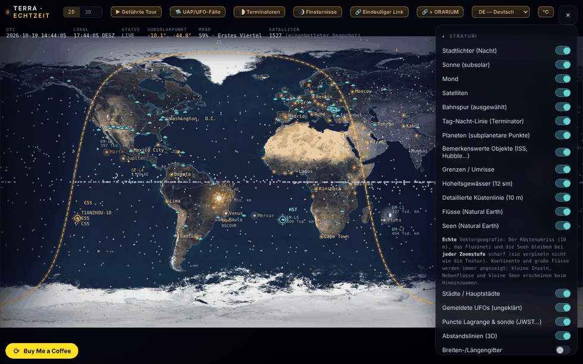

# Terra — die Erde in Echtzeit

[English](README.md) · [Română](README.ro.md) · [Français](README.fr.md) · [Italiano](README.it.md) · [Español](README.es.md) · [Português](README.pt.md) · **Deutsch** · [Magyar](README.hu.md)

**Version:** 2.0.0 · **Zuletzt aktualisiert:** 2026-10-26

Oberflächensprachen: **Română, English, Français, Italiano, Español, Português (PT), Deutsch, Magyar**

Karte und Globus der Erde mit der Tag-Nacht-Grenze (Terminator), dem Mond, den Planeten, Satelliten und einem Modus „Himmel“ (Planetarium), in einer einzigen HTML-Datei.

**Online:** https://chiuta.github.io/TerRa/

## Was es ist

Terra · Echtzeit (Seitentitel: „Die Erde in Echtzeit — Terminator · Mond · Satelliten“) berechnet im Browser die Position von Sonne, Mond, Planeten und Satelliten und zeigt sie auf einer 2D-Karte, auf einem 3D-Globus oder in einer Planetariumsansicht („Himmel“) an. Ein Schnappschuss von Bahndaten ist in die Datei eingebettet, sodass sie auch ohne Internet funktioniert; die Live-Feeds sind optional.

## Funktionen

- Modi: **2D**, **3D** und **Himmel**, dazu geführte Touren: „▶ Geführte Tour“, „🌓 Terminatoren“, „🌒 Finsternisse“ und „🛸 UFO-/UAP-Fälle“.
- Der Tag-Nacht-Terminator in Echtzeit berechnet, Stadtlichter auf der Nachtseite, der Subsolarpunkt, der Sublunarpunkt und die Mondphase.
- Zeitsteuerung: Pause/Wiedergabe, Geschwindigkeiten (1×, 60×, 600×, 3600×, 1 Tag/s), Schnellsprünge (−7 T … +7 T, ±1 Std.) und „Genauer Zeitpunkt (lokal)“; „⦿ Zurück zu jetzt (live)“.
- Satelliten, propagiert mit SGP4 (niedrige Bahnen) und einem Kepler-J2-Modell (geostationär); Kategorien: Raumstationen, mit bloßem Auge sichtbar, Starlink, OneWeb, GPS, Galileo, GLONASS, BeiDou, wissenschaftlich, Wetter, Erdbeobachtung, geostationär; Laden eigener TLE (Text oder Datei).
- Planeten und Pluto/Charon als subplanetare Punkte; bemerkenswerte Objekte (ISS, Tiangong, Hubble), Lagrange-Punkte und Sonden (JWST, Gaia, Euclid, SOHO, DSCOVR); eine Liste gemeldeter UFOs (sie dokumentiert Berichte, behauptet keinen außerirdischen Ursprung).
- Ebenen: Grenzen, Hoheitsgewässer, detaillierte Küste, Flüsse und Seen (Natural Earth), Städte / Hauptstädte, Breiten-/Längengitter, prozedurales fraktales Relief, vertikale Karte für Mobilgeräte.
- Modus „Himmel“: Milchstraße, Messier-Objekte, Sternbilder, Meteorströme, Ekliptik, Beobachter vom Boden oder von anderen Körpern; „Zum Himmel ausrichten (AR)“ mit Kompass/Gyroskop des Telefons.
- Sichtbare ISS-Überflüge in 48 Std., mit Alarm (Vibration + Benachrichtigung); Oberflächenumgebung und Gleichgewichtsgezeiten für den gewählten Ort.
- Optionale Live-Feeds: Flugzeuge (ADS-B), Wetter-Radiosondenballons, Wetterradar, NOAA-Weltraumwetter (Kp, Sonnenwind, Röntgenstrahlung, Polarlichtoval), USGS-Erdbeben (24 Std.), Movebank, GTFS-RT-Feed über einen Proxy.
- Auf dem Telefon im Hochformat: Schaltfläche „⟳ Karte drehen“ (vertikale / horizontale Karte).
- Oberfläche in 8 Sprachen: RO, EN, FR, IT, ES, PT, DE, HU (Sprachwähler).
- Tastenkürzel: `1` / `2` / `3` (2D / 3D / Himmel), `Leertaste` (Pause / Fortsetzen), `N` (zurück zu „jetzt“), `[` und `]` (3D-Perspektive), `Esc`; inaktiv, solange du in ein Feld tippst. Sie sind auch im Fenster „Über“ beschrieben.

## Alle Körper von ORARIUM (1.4.0)

TerRa hat jetzt jeden der 45 Körper von [ORARIUM](https://chiuta.github.io/orarium/) als Beobachter und als Ziel: die Sonne, die Planeten, den Mond, die Satelliten (darunter Phobos, Deimos, Hyperion und Charon, jetzt hinzugefügt), die Zwergplaneten und Asteroiden (Ceres, Vesta, Pallas, Hygiea, Psyche, Eros, Bennu, Ryugu, Haumea, Makemake, Eris) und den Kometen 67P. Der Venus-Aerostat in 50 km Höhe ist kein eigener Körper: Er ist von der Venus aus verlinkt.

- Die Bahnen der Asteroiden und Zwergplaneten verwenden echte Elemente aus JPL SBDB; Ceres, Eros und Eris stimmen mit JPL Horizons überein (≤ 0,007 AE). Bei Bennu ist der Periheldurchgang auf die JPL-Ephemeride vom 2026-10-18 abgestimmt (die JPL-Elemente haben die Epoche 2010). Die neuen Satelliten verwenden dasselbe vereinfachte Kreisbahnmodell wie die übrigen.
- Das Fenster „🕰 Zeit auf anderen Welten“ listet alle 45 Körper auf, mit dem Winkel zur Sonne und „⚠ Konjunktion“, und drei Links pro Zeile: ↗ das Datenblatt in ORARIUM, 📡 das Übertragungsfenster von deinem Standort, 👁 der Himmel von diesem Körper aus, in TerRa.
- Umgekehrt hat ORARIUM „↗ TerRa“ für alle 44 Körper (einschließlich jedes Endes eines Kommunikationspaares).
- Die Ortszeit (Meridian 0) erscheint nur für den Mond und die Planeten; für Satelliten und Asteroiden siehe die Zeit in ORARIUM.

## Die Verbindung zu ORARIUM (1.3.0)

TerRa und [ORARIUM](https://chiuta.github.io/orarium/) (die Zeit auf allen Welten) sind in beide Richtungen verlinkt, durch eindeutige Links, ohne Netzwerk und ohne Server:

- **Das Panel „🕰 Zeit auf anderen Welten“**: die Ortszeit (Meridian 0) auf dem Mond und auf den Planeten zum Zeitpunkt der Zeitleiste, der nächste Mittag und die nächste Mitternacht, der Winkel zur Sonne und das Signal „⚠ Sonnenkonjunktion“. ↗ öffnet den Körper in ORARIUM; 📡 öffnet das Übertragungsfenster von „Mein Standort“.
- **Der Modus „Himmel“ von einem anderen Körper aus**: Unter der Beobachterauswahl erscheint die Ortszeit auf dem Körper (bei Mondsatelliten: die Sonnenzeit auf dem Mond), mit Links zum Datenblatt des Körpers und zum Übertragungsfenster von deinem Standort.
- Die Touren **„Terminatoren“** und **„Finsternisse“**: an jeder Station ein Link „↗ Zeit auf dem Körper / auf dem Mond in ORARIUM“.
- **„🔗 + ORARIUM“**: kopiert zwei eindeutige Links (die Ansicht in TerRa + die entsprechende Zeit/Übertragung in ORARIUM).
- Die Berechnungen im Panel verwenden dieselben Formeln wie ORARIUM (IAU-Orientierungen, vereinfachte Kepler-Ephemeriden; Genauigkeit im Minutenbereich) und liefern identische Ergebnisse.

## Eindeutiger Link (1.2.0)

Die Schaltfläche **„🔗 Eindeutiger Link“** kopiert die genaue Adresse der aktuellen Ansicht: den Modus (2D / 3D / Himmel), den Beobachter im Modus „Himmel“ (vom Mars, von Io …), den Zeitpunkt (UTC) und den Standort. Beim Öffnen stellt der Link die Ansicht wieder her, mit der Zeit fixiert (Pause) auf den Zeitpunkt im Link. Das Format ist ein Adressfragment, ohne Server und ohne Netzwerkanfragen:

`#v=sky&o=mars&t=2026-10-18T15:00:00Z&ll=44.43,26.10`

- `v` = `2d` | `3d` | `sky`; `o` = der Beobachter im „Himmel“ (z. B. `mars`, `jupiter`, `io`, `luna`, `sun`, `ground`); `t` = der ISO-Zeitpunkt in UTC; `ll` = Breite,Länge.
- Fehlende oder ungültige Parameter werden ignoriert. Wird auch von [ORARIUM](https://chiuta.github.io/orarium/) für die Schaltflächen „In TerRa ansehen“ verwendet.

## Neue Funktionen (1.1.0)

Der Abschnitt **„Lokale Ephemeriden“** im Panel (die Zusammenfassungszeile) und das Fenster **„Lokale Ephemeriden öffnen“**, lokal berechnet, ohne Netzwerk, mit `FFF.ephem`, für „Mein Standort“ und den Zeitpunkt der Zeitsteuerung (einschließlich simulierter Zeit):

- **Zusammenfassung** im Panel: Sonnenauf-/-untergang, Mondphase und Beleuchtung.
- **Fenster:** Sonne (Aufgang, Kulmination, Untergang, Tageslänge, Dämmerungen), Mond (Phase, Beleuchtung, Alter, Entfernung, Auf-/Untergang, nächste Phasen) und eine Tabelle mit Sonne, Mond und Planeten (ekliptikale Länge mit Vorzeichen, Höhe/Azimut, Auf-/Untergang, Helligkeit, Elongation).
- Die Zeitzone für die Uhrzeiten: standardmäßig die des Browsers, editierbar (IANA-Name).
- Die angegebene Genauigkeit steht im Fenster; die Zeiten sind auf die Minute gerundet.
- Die Oberfläche hat 8 Sprachen (RO, EN, FR, IT, ES, PT, DE, HU), die im Sprachwähler ausgewählt werden. Die Übersetzungen fr/it/es/pt/de/hu sind **automatisch und nicht muttersprachlich geprüft**.
- Solange das Fenster geöffnet ist, sind die Tastenkürzel der Anwendung (`1`/`2`/`3`/`Leertaste`/`N`) inaktiv; `Esc` schließt das Fenster.

## Bedienungsanleitung

1. Öffne die Seite; wähle in der oberen Leiste **2D**, **3D** oder **Himmel**.
2. Lege den Standort im Panel „Mein Standort“ fest (Schaltfläche „📍 Erkennen“ oder manuelle Koordinaten) für ISS-Überflüge, Gezeiten und die Ansicht vom Boden.
3. Öffne ☰ für „Ebenen“ und die anderen Panels; hake an, was du sehen möchtest.
4. Steuere die Zeit in der unteren Leiste (Pause, Geschwindigkeit, Sprünge, „Genauer Zeitpunkt“); „⦿ Zurück zu jetzt (live)“ kehrt zur aktuellen Zeit zurück.
5. Ziehe zum Drehen/Verschieben, scrolle oder zoome mit zwei Fingern; tippe auf einen Satelliten oder eine Markierung für Details und die Bahnspur. Im 3D-Modus schalten die Tasten `[` und `]` durch die Beobachtungsperspektiven.
6. Für aktuelle Daten: „⟲ Aktualisieren (online)“ im Satellitenpanel; „↺ Zurück zum Offline-Schnappschuss“ stellt die eingebetteten Daten wieder her.
7. Live-Feeds: Drücke die Schaltflächen „Abrufen …“ in den jeweiligen Panels (sie sind standardmäßig aus).
8. Wechsle die Sprache mit der Schaltfläche „EN“/„RO“.

## Datenschutz und Netzwerk

- Die Anwendung verwendet keine Cookies und hat keine Analytics. Im Browser wird nur die gewählte Oberflächensprache gespeichert (`localStorage`, Schlüssel `terra.lang`); alles andere läuft lokal, nichts sonst wird gespeichert.
- Ohne deine Aktionen stellt die Anwendung keine Netzwerkanfragen. Wenn du Online-Funktionen aktivierst, kontaktiert der Browser direkt:
  - `celestrak.org` (Satelliten-TLE) und als Ausweichlösung `raw.githubusercontent.com` (CelesTrak-Spiegel);
  - `services.swpc.noaa.gov` (Weltraumwetter, Polarlichtoval) und `earthquake.usgs.gov` (Erdbeben);
  - `api.open-meteo.com` (aktuelles Wetter am gewählten Ort);
  - `opendata.adsb.fi` und `api.adsb.lol` (Flugzeuge um deinen Standort, die Koordinaten werden in der Anfrage gesendet);
  - `api.v2.sondehub.org` (Radiosondenballons), `api.rainviewer.com` und `tilecache.rainviewer.com` (Wetterradar), `www.movebank.org` (Tierdaten, öffentliche Studien);
  - `corsproxy.io`, nur wenn du einen CORS-Proxy für Quellen eingibst/verwendest, die keinen direkten Zugriff erlauben; der Proxy sieht diese Anfrage (die Anwendung warnt ausdrücklich).
- Die Geolokalisierung („📍 Erkennen“) wird nur auf Tastendruck angefordert; Benachrichtigungen für den ISS-Alarm nur, wenn du den Alarm aktivierst.

- 1.1.0: Die lokalen Ephemeriden stellen keine Netzwerkanfragen und speichern nichts; sie verwenden den bereits festgelegten „Mein Standort“ (die Geolokalisierung „📍 Erkennen“ bleibt wie zuvor auf Anfrage). Das Kit `fff-kit` (`core`, `label`, `bundle`, `ephem`) fügt die Transparenz-Schaltfläche hinzu; beim Start schreibt es nichts in `localStorage`. Die oben aufgeführten Online-Feeds haben sich nicht geändert.
## Hinweis zu den UFO-/UAP-Fällen

Die Fallliste dokumentiert Berichte und behauptet keinen außerirdischen Ursprung. Aussagen, die realen Personen (Zeugen, Ermittlern, Forschern) zugeschrieben werden, sind aus der zitierten Literatur wiedergegeben und **wurden nicht unabhängig überprüft**; der Hinweis erscheint auch auf der Seite (Panel „Gemeldete UFOs“ und Abschnitt „Über“, RO/EN). Die Liste enthält derzeit 94 Fälle (der Text auf der Seite sagt „über 70“, was weiterhin zutrifft).

## Grenzen (neue Funktionen)

- **Lokale Ephemeriden — Genauigkeit.** Gegenüber JPL DE421/DE423: scheinbare Positionen von Sonne und Planeten ≤ 3″ (Neptun ≤ 5″, Pluto ≤ 7″), Mond ≤ 1,5″; Sonnenauf-/-untergang ≤ 6 s, Mond ≤ 25 s; Phasen ≤ 30 s. Gegenüber pyephem 4.2.1 (Test in `tests/`): Auf-/Untergang ≤ 0,5 s, Phasen ≤ 6 s, Höhe/Azimut ≤ 0,003°. Die Zeiten sind auf die Minute gerundet. In der Realität weichen Sonnenauf- und -untergang um Minuten ab (reale Refraktion, Gelände, Höhe — nicht modelliert); ΔT ist für 2027 um ≈ ±1 s unsicher. Nicht für die Navigation geeignet. Die bestehenden Berechnungen von Karte/Globus/Himmel (Terminator, Mond, Planeten in der Ansicht) wurden weder ersetzt noch verändert; die Position der Satelliten bleibt vom Alter der TLE-Elemente abhängig.

## Tests

`node tests/fff-r8.test.mjs` (Playwright aus `/opt/node-tools`, lokales Chromium, Netzwerk blockiert; `tests/_lib.mjs` enthält die gemeinsamen Hilfsfunktionen). Die Referenzwerte stehen in `tests/ref-c3a.json`: die Zeitpunkte für Auf-/Untergang/Kulmination (Sonne, Mond; 5 Orte × 4 Daten), 56 Phasenzeitpunkte und 54 Höhe/Azimut-Positionen, unabhängig mit **pyephem 4.2.1** berechnet (nur offline zur Erzeugung der Zahlen verwendet; nicht Teil der Anwendung). Jeder Test hat seinen Schwellenwert im Code; der Barrierefreiheitstest (axe-core, `bypassCSP`) läuft auch in geöffneten Dialogen/Panels, bei 1280×800 und 360×740.

## Lokal / offline ausführen

Lade `index.html` herunter und öffne sie im Browser. Die Position von Sonne, Mond, Planeten, der Terminator, die Finsternisse und die Satelliten des eingebetteten Schnappschusses funktionieren ohne Internet; die TLE-Aktualisierung und die Live-Feeds benötigen Internet.

## Lizenz

MIT — siehe Datei LICENSE

## Audit

2026-10-10: Im Browser überprüft, dass beim Laden und im Ruhezustand keine Netzwerkanfrage abgeht; Anfragen erscheinen nur bei den oben beschriebenen Aktionen. Die Seite hatte keine CSP-Richtlinie; am 2026-10-11 wurde eine hinzugefügt, mit auf `https:` beschränktem `connect-src`/`img-src` (nicht auf eine feste Liste von Hosts), weil der CORS-Proxy, die GTFS-RT-Adresse und das BirdCast-Bild vom Nutzer eingegeben werden und auf jeder HTTPS-Domain liegen können. Die Barrierefreiheit wurde korrigiert (Namen für Schalter, Zoom erlaubt), ohne funktionale Änderungen.

## Autor

Alexio — Alexandru-Ionuț Chiuță. Kontakt: alexio@trom.tf

## Verlauf / Changelog
- **1.7.8 — 2026-10-22:** Text und Ziele: mindestens 12 px in den Auswahlkarten (Telemetriewerte, Tags), dem Tour-Zähler, den Tastaturhinweisen und den Fußnoten; die Links der Ephemeriden-Konsole (↗ 📡 👁) sind mindestens 24 px groß (44 px bei grobem Zeiger). Erneute Prüfung bei 360 und 1366 px: kein Ziel unter 24 px und kein Text unter 12 px.

### 1.7.7 — 2026-10-22

fff-kit 1.1.4: Touch-Ziele und Mindestschriftgröße; Touch-Ziele und Text korrigiert.

### 1.7.6 — 2026-10-22
- fff-kit 1.1.2: PBKDF2 mit 600.000 Iterationen, Schutz vor Clickjacking

### 1.7.5 — 2026-10-22
- Mobil: Der Text ist mindestens 12 px groß, und Schaltflächen und Felder haben auf schmalen Bildschirmen größere Touch-Flächen.
- Barrierefreiheit: Das TLE-Einfügefeld, die Felder der Live-Feeds (GTFS-RT, Movebank, BirdCast, CORS-Proxy) und die Breiten-/Längengrad-Felder haben jetzt Namen, die Screenreader ansagen (8 Sprachen).
- Auf schmalen Bildschirmen ist die schwebende Schaltfläche „Buy Me a Coffee“ ausgeblendet, solange das Bedienfeld geöffnet ist; sie verdeckt den Text des Feldes also nicht mehr.

- 1.7.4 — 2026-10-22: **Korrektur**: Planetennamen, der Hubble-Eintrag, die Beschriftungen „Schneller Sprung“ und „Genauer Zeitpunkt (lokal)“ sowie das Etikett der UFO-Karte folgen jetzt der Oberflächensprache; die Listen der Planeten, markanten Objekte und Lagrange-Punkte werden beim Sprachwechsel neu aufgebaut.
### 22. Oktober 2026 (v1.7.3)
- Das Tag/Nacht-Widget („Zeit auf dem Körper“) repariert: Die Erdzeile zeigt nicht mehr „Winkel zur Sonne NaN°“ oder eine absurde Minutenzahl bis Mittag/Mitternacht (der Sonnentag der Erde fehlte in der Periodentabelle, und der Winkel zur Sonne wurde für die Erde gegen sich selbst berechnet).
- Oberfläche: die Absätze der Anleitung, der Abschnitt „Eigenes TLE laden“, die Gezeitenbeschriftungen, die Fallbeschriftungen („Berichte“, „von 1981“), die Legende der Satellitenkategorien, die Schaltflächen „Vor/Zurück“ sowie Seitentitel und -beschreibung folgen jetzt in allen 8 Sprachen der Oberflächensprache.

### 21. Oktober 2026 (v1.7.2)
- Karte und Tourschritt zu Valea Plopului wurden umformuliert und mit Quellenzuschreibung versehen: „laut Berichten … in den zitierten Quellen als erster beglaubigter und begutachteter Fall dargestellt … nicht unabhängig überprüft; der Fall bleibt umstritten“ (nicht mehr als Tatsache formuliert); das Datum lautet „September 1972“, der Ort „Poșești“, die Messung wird Justin Capră „laut Berichten“ zugeschrieben. Die Tour-Legende ist jetzt in fr/it/es/pt/de/hu übersetzt (zuvor fiel sie auf Englisch zurück). Der Text zu Valea Plopului ist mit ValeaPlopului1972 abgeglichen; Test `tests/vp-case.test.mjs`.

### 19. Oktober 2026 (v1.6.0)
- Neu: „↗ Bolta“ im Modus Himmel (vom Boden): derselbe Zeitpunkt und derselbe Standort im Offline-Planetarium Bolta; ohne t=, wenn die Zeit „jetzt“ ist, außerhalb von 1900–2100 ausgeblendet.
- Datenschutz: Ein per GPS ermittelter Standort wird in den Links zu ORARIUM und Bolta auf ~1 km gerundet.
- „← zurück“ für die Quellen ECLIPSA, Eclipsa 2027, Horoscop, Field Observer, Horizons.
- Die Schaltfläche „← zurück“ wird nicht mehr vom Widget Buy Me a Coffee (unten links) verdeckt: Sie sitzt darüber.
- Ein dezenter Hinweis „Geringere Genauigkeit nach 2100: ΔT extrapoliert, Pluto nicht verfügbar.“ (ro/en, hu/de über en) nur, wenn das simulierte Datum oder das aus `t=` 2100 überschreitet.

### 18. Oktober 2026 (v1.5.0)
- Neu: Der Parameter `ufo=<Fall>` (z. B. `#v=2d&ufo=valea-plopului`) zentriert die 2D-Karte auf den Fall aus der UFO-Liste und öffnet die Karte, ohne „Mein Standort“ zu ändern; unbekannte Werte werden ignoriert. `from=valeaplopului` zeigt die Schaltfläche „← zurück“ zu ValeaPlopului1972. Der Text des Falls wurde nicht verändert.

### 18. Oktober 2026 (v1.4.0)
- Neu: alle 45 Körper von ORARIUM, mit 15 hinzugefügten Körpern (Phobos, Deimos, Hyperion, Charon, Ceres, Vesta, Pallas, Hygiea, Psyche, Eros, Bennu, Ryugu, Haumea, Makemake, Eris) als Beobachter und Ziele; das ORARIUM-Panel listet alle Körper auf, mit Links in beide Richtungen.

### 18. Oktober 2026 (v1.3.0)
- Neu: die Verbindung zu ORARIUM (Panel „Zeit auf anderen Welten“, Banner im Modus Himmel, Links in den Touren, kombinierter Link „🔗 + ORARIUM“).

### 18. Oktober 2026 (v1.2.0)
- Neu: eindeutiger Link (URL-Fragment) für Modus, Beobachter, Zeitpunkt und Standort, dazu die Schaltfläche „🔗 Eindeutiger Link“; Verbindung zu ORARIUM.

### 14. Oktober 2026 (v1.1.0)
- Neu: „Lokale Ephemeriden“ (Zusammenfassungszeile im Panel + modales Fenster: Sonne, Mond, Phasen, Planeten, Dämmerungen, editierbare Zeitzone, angegebene Genauigkeit); Sprachzyklus RO/EN/HU/DE für die neuen Funktionen; das Kit `fff-kit` (`core`, `label`, `bundle`, `ephem`); `tests/fff-r8.test.mjs` (51 Prüfungen, einschließlich axe im hellen und dunklen Design, bei 1280×800 und 360×740, mit geöffnetem Fenster). Vorher/nachher-Vergleich bei 1280×800: Unterschiede unter 0,05 % der Pixel (Animations-/WebGL-Rauschen), der Screenshot hat sich nicht geändert; der neue Abschnitt befindet sich im Bedienpanel.

### 12. Oktober 2026 (v1.0.0)
- 1.0.0 — 2026-10-12: Die Version und das Datum der letzten Aktualisierung werden in der Anwendung angezeigt

### 11. Oktober 2026
- Behoben (alter Fehler in der HTML-Struktur): Ein überzähliges `
` schloss das Bedienpanel vorzeitig, sodass neun Abschnitte (Mondphase, Planeten, Mein Standort, Oberflächenumgebung, Gezeiten usw.) aus dem Panel herausfielen und nicht bedienbar waren; jetzt befinden sich alle 19 Abschnitte im Panel, und die Zeitsteuerung hat den Titel „Zeit — Vergangenheit / Zukunft“.
- „Mein Standort“: Das Dezimalkomma wird akzeptiert (`44,43`), und Koordinaten außerhalb des Bereichs führen zu einer Fehlermeldung, statt stillschweigend beschnitten zu werden.
- Schaltfläche „⟳ Karte drehen“ in der Kopfzeile (nur in 2D, auf schmalem Bildschirm im Hochformat), um schnell zwischen vertikaler und horizontaler Karte zu wechseln; die Beschriftungen bleiben in horizontaler Ausrichtung lesbar.
- Tastenkürzel (1/2/3, Leertaste, N), mit EN-Übersetzung im Fenster „Über“.
- Die Beschriftungen in der 2D-Karte (Stationen, Planeten, Lagrange-Punkte, Sonden, Sonne, Mond, bemerkenswerte Objekte) überlappen sich nicht mehr: Sie werden vertikal verschoben oder weggelassen.
- CSP: `script-src` per SHA-256-Hash für die beiden Skripte, ohne `'unsafe-inline'` (Verbindungen bleiben `https:`).
- Auf Telefonen im Hochformat startet die 2D-Karte jetzt im Modus „Vertikale Karte“ (füllt den Bildschirm, Beschriftungen leichter lesbar); die obere Leiste hat einen halbtransparenten Hintergrund.
- Das Panel „Datenquelle (TLE)“ warnt, wenn die eingebetteten Bahnelemente alt sind (>7 Tage; am 11.10.2026 ist der Schnappschuss ~107 Tage alt, mediane Epoche 2026-06-26): Die Satellitenpositionen sind bis „Aktualisieren (online)“ näherungsweise.
- Der Inhalt ist in `<main>` eingefasst (axe: 0 Verstöße); eine CSP wurde hinzugefügt (`default-src 'none'`, keine externen Skripte, nur `https:` für Verbindungen).
- Ungelöst: die Größe von 2,1 MB (JPEG-Texturen + eingebettete Natural-Earth-Daten); eine Neukomprimierung der Bilder würde nur ~5 % bei sichtbarem Verlust bringen.
