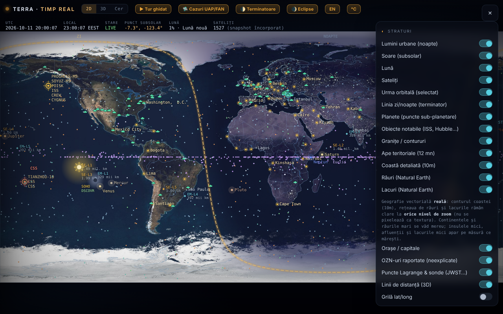

# Terra — la Tierra en tiempo real

[English](README.md) · [Română](README.ro.md) · [Français](README.fr.md) · [Italiano](README.it.md) · **Español** · [Português](README.pt.md) · [Deutsch](README.de.md) · [Magyar](README.hu.md)

**Versión:** 1.6.0 · **Última actualización:** 2026-10-19

Mapa y globo de la Tierra con el terminador día/noche, la Luna, los planetas, los satélites y un modo «Cielo» (planetario), en un único archivo HTML.

**En línea:** https://chiuta.github.io/TerRa/

## Qué es

Terra · tiempo real (título de la página: «La Tierra en tiempo real — Terminador · Luna · Satélites») calcula en el navegador la posición del Sol, la Luna, los planetas y los satélites y los muestra en un mapa 2D, en un globo 3D o en una vista de planetario («Cielo»). Una instantánea de datos orbitales está incorporada en el archivo, por lo que funciona también sin internet; los feeds en directo son opcionales.

## Funciones

- Modos: **2D**, **3D** y **Cielo**, además de visitas guiadas: «▶ Visita guiada», «🌓 Terminadores», «🌒 Eclipses» y «🛸 Casos OVNI/FANI».
- El terminador día/noche calculado en tiempo real, luces urbanas en el lado nocturno, el punto subsolar, el punto sublunar y la fase de la Luna.
- Control del tiempo: pausa/reproducción, velocidades (1×, 60×, 600×, 3600×, 1 día/s), saltos rápidos (−7d … +7d, ±1h) y «Momento exacto (local)»; «⦿ Volver a ahora (en directo)».
- Satélites propagados con SGP4 (órbitas bajas) y un modelo kepleriano-J2 (geoestacionarios); categorías: estaciones espaciales, visibles a simple vista, Starlink, OneWeb, GPS, Galileo, GLONASS, BeiDou, científicos, meteorológicos, observación de la Tierra, geoestacionarios; carga de TLE propios (texto o archivo).
- Planetas y Plutón/Caronte como puntos subplanetarios; objetos notables (ISS, Tiangong, Hubble), puntos de Lagrange y sondas (JWST, Gaia, Euclid, SOHO, DSCOVR); lista de OVNIs reportados (documenta relatos, no afirma origen extraterrestre).
- Capas: fronteras, aguas territoriales, costa detallada, ríos y lagos (Natural Earth), ciudades / capitales, cuadrícula lat/long, relieve fractal procedimental, mapa vertical para móvil.
- Modo «Cielo»: Vía Láctea, objetos Messier, constelaciones, lluvias de meteoros, eclíptica, observador desde el suelo o desde otros cuerpos; «Apuntar al cielo (AR)» con la brújula/el giroscopio del teléfono.
- Pasos visibles de la ISS en 48 h, con alerta (vibración + notificación); entorno de superficie y mareas de equilibrio para la ubicación elegida.
- Feeds en directo opcionales: aviones (ADS-B), globos sonda meteorológicos, radar meteorológico, meteorología espacial de NOAA (Kp, viento solar, rayos X, óvalo auroral), terremotos USGS (24 h), Movebank, flujo GTFS-RT mediante proxy.
- En el teléfono en vertical: botón «⟳ Girar el mapa» (mapa vertical / horizontal).
- Interfaz en rumano e inglés (botón «EN» / «RO»); desde la 1.1.0 el ciclo incluye también HU/DE para las funciones nuevas.
- Atajos de teclado: `1` / `2` / `3` (2D / 3D / Cielo), `Espacio` (pausa / reanudar), `N` (volver a «ahora»), `[` y `]` (perspectiva 3D), `Esc`; inactivos mientras escribes en un campo. También se describen en la ventana «Acerca de».

## Todos los cuerpos de ORARIUM (1.4.0)

TerRa tiene ahora como observador y como objetivo cada uno de los 45 cuerpos de [ORARIUM](https://chiuta.github.io/orarium/): el Sol, los planetas, la Luna, los satélites (incluidos Fobos, Deimos, Hiperión y Caronte, añadidos ahora), los planetas enanos y los asteroides (Ceres, Vesta, Palas, Higía, Psique, Eros, Bennu, Ryugu, Haumea, Makemake, Eris) y el cometa 67P. El aerostato de Venus a 50 km no es un cuerpo aparte: tiene un enlace desde Venus.

- Las órbitas de los asteroides y de los planetas enanos usan elementos reales de JPL SBDB; Ceres, Eros y Eris coinciden con JPL Horizons (≤ 0,007 UA). Para Bennu, el instante del perihelio se ajusta a la efeméride JPL del 2026-10-18 (los elementos JPL tienen época 2010). Los satélites nuevos usan el mismo modelo circular simplificado que el resto.
- El panel «🕰 La hora en otros mundos» enumera los 45 cuerpos, con el ángulo respecto al Sol y «⚠ conjunción», y tres enlaces por fila: ↗ la ficha en ORARIUM, 📡 la ventana de transmisión desde tu ubicación, 👁 el cielo desde ese cuerpo, en TerRa.
- A la inversa, ORARIUM tiene «↗ TerRa» para los 44 cuerpos (incluido cada extremo de un par de comunicación).
- La hora local (meridiano 0) aparece solo para la Luna y los planetas; para los satélites y los asteroides consulta la hora en ORARIUM.

## El vínculo con ORARIUM (1.3.0)

TerRa y [ORARIUM](https://chiuta.github.io/orarium/) (la hora en todos los mundos) están enlazados en ambos sentidos, mediante enlaces únicos, sin red y sin servidor:

- **El panel «🕰 La hora en otros mundos»**: la hora local (meridiano 0) en la Luna y en los planetas en el instante de la barra de tiempo, el próximo mediodía y la próxima medianoche, el ángulo respecto al Sol y la señal «⚠ conjunción solar». ↗ abre el cuerpo en ORARIUM; 📡 abre la ventana de transmisión desde «Mi ubicación».
- **El modo «Cielo» desde otro cuerpo**: bajo el selector de observador aparece la hora local en el cuerpo (para los satélites lunares: la hora solar en la Luna), con enlaces a la ficha del cuerpo y a la ventana de transmisión desde tu ubicación.
- Las visitas **«Terminadores»** y **«Eclipses»**: en cada parada, un enlace «↗ La hora en el cuerpo / en la Luna en ORARIUM».
- **«🔗 + ORARIUM»**: copia dos enlaces únicos (la vista en TerRa + la hora/transmisión correspondiente en ORARIUM).
- Los cálculos del panel usan las mismas fórmulas que ORARIUM (orientaciones de la UAI, efemérides keplerianas simplificadas; precisión del orden de los minutos) y dan resultados idénticos.

## Enlace único (1.2.0)

El botón **«🔗 Enlace único»** copia la dirección exacta de la vista actual: el modo (2D / 3D / Cielo), el observador en el modo Cielo (desde Marte, desde Ío…), el instante (UTC) y la ubicación. Al abrirlo, el enlace restablece la vista, con el tiempo fijado (en pausa) en el instante del enlace. El formato es un fragmento de dirección, sin servidor y sin solicitudes de red:

`#v=sky&o=mars&t=2026-10-18T15:00:00Z&ll=44.43,26.10`

- `v` = `2d` | `3d` | `sky`; `o` = el observador en «Cielo» (p. ej. `mars`, `jupiter`, `io`, `luna`, `sun`, `ground`); `t` = el instante ISO en UTC; `ll` = latitud,longitud.
- Los parámetros ausentes o no válidos se ignoran. Lo usa también [ORARIUM](https://chiuta.github.io/orarium/) para los botones «Ver en TerRa».

## Funciones nuevas (1.1.0)

La sección **«Efemérides locales»** del panel (la línea de resumen) y la ventana **«Abrir las efemérides locales»**, calculadas localmente, sin red, con `FFF.ephem`, para «Mi ubicación» y el instante del control de tiempo (incluido el tiempo simulado):

- **Resumen** en el panel: salida/puesta del Sol, fase de la Luna e iluminación.
- **Ventana:** Sol (salida, tránsito, puesta, duración del día, crepúsculos), Luna (fase, iluminación, edad, distancia, salida/puesta, próximas fases) y una tabla con el Sol, la Luna y los planetas (longitud eclíptica con signo, altitud/acimut, salida/puesta, magnitud, elongación).
- La zona horaria para las horas: la del navegador por defecto, editable (nombre IANA).
- La precisión declarada está en la ventana; las horas se redondean al minuto.
- El ciclo de idiomas es ahora RO → EN → HU → DE (el botón de la cabecera); los textos antiguos de la aplicación siguen en rumano/inglés (en HU/DE se ve el inglés), las funciones nuevas tienen los cuatro idiomas. Las traducciones al húngaro (hu) y al alemán (de) de las funciones nuevas son **automáticas y no verificadas por nativos**; lo mismo valdría para cualquier otro idioma añadido después (fr/it/es/pt no se ofrecen en esta aplicación).
- Mientras la ventana está abierta, los atajos de teclado de la aplicación (`1`/`2`/`3`/`Espacio`/`N`) están inactivos; `Esc` cierra la ventana.

## Manual de uso

1. Abre la página; elige **2D**, **3D** o **Cielo** en la barra superior.
2. Establece la ubicación en el panel «Mi ubicación» (botón «📍 Detectar» o coordenadas manuales) para los pasos de la ISS, las mareas y la vista desde el suelo.
3. Abre ☰ para «Capas» y los demás paneles; marca lo que quieras ver.
4. Controla el tiempo desde la barra inferior (pausa, velocidad, saltos, «Momento exacto»); «⦿ Volver a ahora (en directo)» vuelve a la hora actual.
5. Arrastra para girar/desplazar, desplaza la rueda o pellizca para hacer zoom; toca un satélite o un marcador para ver detalles y la traza orbital. En modo 3D, las teclas `[` y `]` recorren las perspectivas de observación.
6. Para datos actuales: «⟲ Actualizar (en línea)» en el panel de satélites; «↺ Volver a la instantánea sin conexión» restablece los datos incorporados.
7. Feeds en directo: pulsa los botones «Traer …» de los paneles correspondientes (están desactivados por defecto).
8. Cambia el idioma con el botón «EN»/«RO».

## Privacidad y red

- La aplicación no usa cookies, `localStorage` ni ningún otro tipo de almacenamiento local (no encontré llamadas de almacenamiento en el código) y no tiene analítica.
- Sin tus acciones, la aplicación no realiza solicitudes de red. Cuando activas funciones en línea, el navegador contacta directamente con:
  - `celestrak.org` (TLE de satélites) y, como respaldo, `raw.githubusercontent.com` (espejo de CelesTrak);
  - `services.swpc.noaa.gov` (meteorología espacial, óvalo auroral) y `earthquake.usgs.gov` (terremotos);
  - `api.open-meteo.com` (tiempo actual en la ubicación elegida);
  - `opendata.adsb.fi` y `api.adsb.lol` (aviones alrededor de tu ubicación, las coordenadas se envían en la solicitud);
  - `api.v2.sondehub.org` (globos sonda), `api.rainviewer.com` y `tilecache.rainviewer.com` (radar meteorológico), `www.movebank.org` (datos de animales, estudios públicos);
  - `corsproxy.io`, solo si introduces/usas un proxy CORS para fuentes que no permiten el acceso directo; el proxy ve esa solicitud (la aplicación lo advierte explícitamente).
- La geolocalización («📍 Detectar») se solicita solo al pulsar; las notificaciones de la alerta de la ISS solo si activas la alerta.

- 1.1.0: las efemérides locales no realizan solicitudes de red y no almacenan nada; usan «Mi ubicación» ya establecida (la geolocalización «📍 Detectar» sigue siendo a petición, como antes). El kit `fff-kit` (`core`, `label`, `bundle`, `ephem`) añade el botón de transparencia; al arrancar no escribe nada en `localStorage`. Los feeds en línea enumerados arriba no han cambiado.
## Nota sobre los casos OVNI/FANI

La lista de casos documenta relatos y no afirma origen extraterrestre. Las afirmaciones atribuidas a personas reales (testigos, investigadores, científicos) se reproducen de la literatura citada y **no han sido verificadas de forma independiente**; la nota aparece también en la página (panel «OVNIs reportados» y sección «Acerca de», RO/EN). La lista contiene actualmente 94 casos (el texto de la página dice «más de 70», lo cual sigue siendo cierto).

## Límites (funciones nuevas)

- **Efemérides locales — precisión.** Respecto a JPL DE421/DE423: posiciones aparentes del Sol y de los planetas ≤ 3″ (Neptuno ≤ 5″, Plutón ≤ 7″), Luna ≤ 1,5″; salida/puesta del Sol ≤ 6 s, de la Luna ≤ 25 s; fases ≤ 30 s. Respecto a pyephem 4.2.1 (prueba en `tests/`): salida/puesta ≤ 0,5 s, fases ≤ 6 s, alt/az ≤ 0,003°. Las horas se redondean al minuto. En la realidad la salida y la puesta difieren en minutos (refracción real, relieve, altitud — no modelados); ΔT es incierto en ≈ ±1 s en 2027. No es apto para la navegación. Los cálculos existentes del mapa/globo/cielo (terminador, Luna, planetas en la vista) no se han sustituido ni modificado; la posición de los satélites sigue dependiendo de la antigüedad de los elementos TLE.

## Pruebas

`node tests/fff-r8.test.mjs` (Playwright desde `/opt/node-tools`, Chromium local, red bloqueada; `tests/_lib.mjs` contiene las utilidades comunes). Los valores de referencia están en `tests/ref-c3a.json`: los instantes de salida/puesta/tránsito (Sol, Luna; 5 lugares × 4 fechas), 56 instantes de fase y 54 posiciones alt/az, calculados de forma independiente con **pyephem 4.2.1** (usado solo sin conexión para generar los números; no forma parte de la aplicación). Cada prueba tiene su umbral escrito en el código; la prueba de accesibilidad (axe-core, `bypassCSP`) se ejecuta también en diálogos/paneles abiertos, a 1280×800 y 360×740.

## Ejecución local / sin conexión

Descarga `index.html` y ábrelo en el navegador. La posición del Sol, la Luna y los planetas, el terminador, los eclipses y los satélites de la instantánea incorporada funcionan sin internet; la actualización de los TLE y los feeds en directo requieren internet.

## Licencia

MIT — véase el archivo LICENSE

## Auditoría

2026-10-10: verificado en el navegador que al cargar y en reposo no sale ninguna solicitud de red; las solicitudes aparecen solo con las acciones descritas arriba. La página no tenía política CSP; el 2026-10-11 se añadió una, con `connect-src`/`img-src` limitados a `https:` (no a una lista fija de hosts), porque el proxy CORS, la dirección GTFS-RT y la imagen de BirdCast los introduce el usuario y pueden estar en cualquier dominio HTTPS. Se corrigió la accesibilidad (nombres para los interruptores, zoom permitido) sin cambios funcionales.

## Autor

Alexio — Alexandru-Ionuț Chiuță. Contacto: alexio@trom.tf

## Historial / Changelog

### 19 de octubre de 2026 (v1.6.0)
- Novedad: «↗ Bolta» en modo Cielo (desde el suelo): el mismo instante y la misma ubicación en el planetario sin conexión Bolta; sin t= cuando la hora es «ahora», oculto fuera de 1900–2100.
- Privacidad: una ubicación tomada del GPS se redondea a ~1 km en los enlaces a ORARIUM y Bolta.
- «← atrás» para las fuentes ECLIPSA, Eclipsa 2027, Horoscop, Field Observer, Horizons.
- El botón «← atrás» ya no queda tapado por el widget Buy Me a Coffee (abajo a la izquierda): queda por encima.
- Una advertencia discreta «Precisión reducida después de 2100: ΔT extrapolado, Plutón no disponible.» (ro/en, hu/de mediante en) solo cuando la fecha simulada o la de `t=` supera 2100.

### 18 de octubre de 2026 (v1.5.0)
- Novedad: el parámetro `ufo=<caso>` (p. ej. `#v=2d&ufo=valea-plopului`) centra el mapa 2D en el caso de la lista OVNI y abre la ficha, sin cambiar «Mi ubicación»; los valores desconocidos se ignoran. `from=valeaplopului` muestra el botón «← atrás» hacia ValeaPlopului1972. El texto del caso no se modificó.

### 18 de octubre de 2026 (v1.4.0)
- Novedad: los 45 cuerpos de ORARIUM, con 15 cuerpos añadidos (Fobos, Deimos, Hiperión, Caronte, Ceres, Vesta, Palas, Higía, Psique, Eros, Bennu, Ryugu, Haumea, Makemake, Eris) como observadores y objetivos; el panel ORARIUM enumera todos los cuerpos, con enlaces en ambos sentidos.

### 18 de octubre de 2026 (v1.3.0)
- Novedad: el vínculo con ORARIUM (panel «La hora en otros mundos», banner en modo Cielo, enlaces en las visitas, enlace combinado «🔗 + ORARIUM»).

### 18 de octubre de 2026 (v1.2.0)
- Novedad: enlace único (fragmento de URL) para modo, observador, instante y ubicación, además del botón «🔗 Enlace único»; vínculo con ORARIUM.

### 14 de octubre de 2026 (v1.1.0)
- Novedad: «Efemérides locales» (línea de resumen en el panel + ventana modal: Sol, Luna, fases, planetas, crepúsculos, zona horaria editable, precisión declarada); ciclo de idiomas RO/EN/HU/DE para las funciones nuevas; el kit `fff-kit` (`core`, `label`, `bundle`, `ephem`); `tests/fff-r8.test.mjs` (51 comprobaciones, incluido axe en los temas claro y oscuro, a 1280×800 y 360×740, con la ventana abierta). Comparación antes/después a 1280×800: diferencias inferiores al 0,05 % de los píxeles (ruido de animación/WebGL), la captura de pantalla no cambió; la nueva sección está en el panel de controles.

### 12 de octubre de 2026 (v1.0.0)
- 1.0.0 — 2026-10-12: la versión y la fecha de la última actualización se muestran en la aplicación

### 11 de octubre de 2026
- Corregido (antiguo defecto de estructura HTML): un `
` de más cerraba prematuramente el panel de controles, por lo que nueve secciones (Fase de la Luna, Planetas, Mi ubicación, Entorno de superficie, Mareas, etc.) quedaban fuera del panel y no se podían tocar; ahora las 19 secciones están en el panel, y el control del tiempo tiene el título «Tiempo — pasado / futuro».
- «Mi ubicación»: se acepta la coma decimal (`44,43`), y las coordenadas fuera de rango dan un mensaje de error en lugar de recortarse en silencio.
- Botón «⟳ Girar el mapa» en la cabecera (solo en 2D, en pantalla estrecha en vertical) para alternar rápidamente entre el mapa vertical y el horizontal; las etiquetas siguen siendo legibles en orientación horizontal.
- Atajos de teclado (1/2/3, Espacio, N), con traducción EN en la ventana «Acerca de».
- Las etiquetas del mapa 2D (estaciones, planetas, puntos de Lagrange, sondas, Sol, Luna, objetos notables) ya no se superponen: se desplazan en vertical o se omiten.
- CSP: `script-src` mediante hash SHA-256 para los dos scripts, sin `'unsafe-inline'` (las conexiones siguen siendo `https:`).
- En los teléfonos en vertical el mapa 2D arranca ahora en modo «Mapa vertical» (llena la pantalla, las etiquetas son más legibles); la barra superior tiene fondo semitransparente.
- El panel «Fuente de datos (TLE)» avisa cuando los elementos orbitales incorporados son antiguos (>7 días; a 11.10.2026 la instantánea tiene ~107 días, época mediana 2026-06-26): las posiciones de los satélites son aproximadas hasta «Actualizar (en línea)».
- El contenido está envuelto en `<main>` (axe: 0 infracciones); se añadió una CSP (`default-src 'none'`, sin scripts externos, solo `https:` para las conexiones).
- Sin resolver: el tamaño de 2,1 MB (texturas JPEG + datos de Natural Earth incorporados); recomprimir las imágenes solo ganaría ~5 % con pérdida visible.
