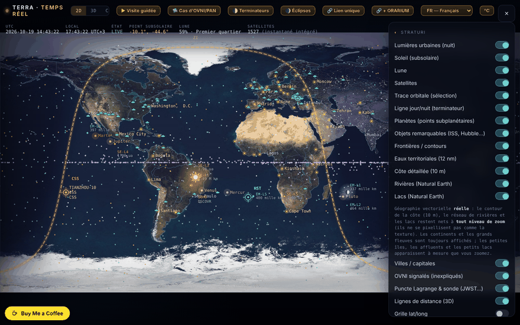

# Terra — la Terre en temps réel

[English](README.md) · [Română](README.ro.md) · **Français** · [Italiano](README.it.md) · [Español](README.es.md) · [Português](README.pt.md) · [Deutsch](README.de.md) · [Magyar](README.hu.md)

**Version :** 1.7.9 · **Dernière mise à jour :** 2026-10-23

Langues de l'interface : **Română, English, Français, Italiano, Español, Português (PT), Deutsch, Magyar**

Carte et globe de la Terre avec le terminateur jour/nuit, la Lune, les planètes, les satellites et un mode « Ciel » (planétarium), dans un seul fichier HTML.

**En ligne :** https://chiuta.github.io/TerRa/

## Qu'est-ce que c'est

Terra · temps réel (titre de la page : « La Terre en temps réel — Terminateur · Lune · Satellites ») calcule dans le navigateur la position du Soleil, de la Lune, des planètes et des satellites, et les affiche sur une carte 2D, sur un globe 3D ou dans une vue de planétarium (« Ciel »). Un instantané de données orbitales est intégré au fichier, de sorte que l'application fonctionne aussi sans internet ; les flux en direct sont facultatifs.

## Fonctions

- Modes : **2D**, **3D** et **Ciel**, plus des visites guidées : « ▶ Visite guidée », « 🌓 Terminateurs », « 🌒 Éclipses » et « 🛸 Cas OVNI/PAN ».
- Le terminateur jour/nuit calculé en temps réel, les lumières des villes côté nuit, le point subsolaire, le point sublunaire et la phase de la Lune.
- Contrôle du temps : pause/lecture, vitesses (1×, 60×, 600×, 3600×, 1 jour/s), sauts rapides (−7 j … +7 j, ±1 h) et « Instant exact (local) » ; « ⦿ Revenir à maintenant (direct) ».
- Satellites propagés avec SGP4 (orbites basses) et un modèle képlérien-J2 (géostationnaires) ; catégories : stations spatiales, visibles à l'œil nu, Starlink, OneWeb, GPS, Galileo, GLONASS, BeiDou, scientifiques, météo, observation de la Terre, géostationnaires ; chargement de vos propres TLE (texte ou fichier).
- Planètes et Pluton/Charon comme points subplanétaires ; objets remarquables (ISS, Tiangong, Hubble), points de Lagrange et sondes (JWST, Gaia, Euclid, SOHO, DSCOVR) ; liste d'OVNI signalés (elle documente des témoignages, elle n'affirme aucune origine extraterrestre).
- Couches : frontières, eaux territoriales, côte détaillée, fleuves et lacs (Natural Earth), villes / capitales, grille lat/long, relief fractal procédural, carte verticale pour mobile.
- Mode « Ciel » : Voie lactée, objets Messier, constellations, essaims de météores, écliptique, observateur au sol ou sur d'autres corps ; « Pointer vers le ciel (AR) » avec la boussole/le gyroscope du téléphone.
- Passages visibles de l'ISS sur 48 h, avec alerte (vibration + notification) ; environnement de surface et marées d'équilibre pour le lieu choisi.
- Flux en direct facultatifs : avions (ADS-B), ballons-sondes météo, radar météo, météo spatiale NOAA (Kp, vent solaire, rayons X, ovale auroral), séismes USGS (24 h), Movebank, flux GTFS-RT via un proxy.
- Sur téléphone en portrait : bouton « ⟳ Pivoter la carte » (carte verticale / horizontale).
- Interface en 8 langues : RO, EN, FR, IT, ES, PT, DE, HU (sélecteur de langue).
- Raccourcis clavier : `1` / `2` / `3` (2D / 3D / Ciel), `Espace` (pause / reprise), `N` (retour à « maintenant »), `[` et `]` (perspective 3D), `Échap` ; inactifs pendant la saisie dans un champ. Ils sont aussi décrits dans la fenêtre « À propos ».

## Tous les corps d'ORARIUM (1.4.0)

TerRa dispose désormais, comme observateur et comme cible, de chacun des 45 corps d'[ORARIUM](https://chiuta.github.io/orarium/) : le Soleil, les planètes, la Lune, les satellites (dont Phobos, Déimos, Hypérion et Charon, ajoutés à présent), les planètes naines et les astéroïdes (Cérès, Vesta, Pallas, Hygie, Psyché, Éros, Bennu, Ryugu, Haumea, Makémaké, Éris) et la comète 67P. L'aérostat Vénus à 50 km n'est pas un corps distinct : il est accessible par un lien depuis Vénus.

- Les orbites des astéroïdes et des planètes naines utilisent de vrais éléments JPL SBDB ; Cérès, Éros et Éris coïncident avec JPL Horizons (≤ 0,007 UA). Pour Bennu, l'instant du périhélie est ajusté sur l'éphéméride JPL du 2026-10-18 (les éléments JPL ont une époque de 2010). Les nouveaux satellites utilisent le même modèle circulaire simplifié que les autres.
- Le panneau « 🕰 L'heure sur d'autres mondes » liste les 45 corps, avec l'angle par rapport au Soleil et « ⚠ conjonction », et trois liens par ligne : ↗ la fiche dans ORARIUM, 📡 la fenêtre de transmission depuis votre lieu, 👁 le ciel depuis ce corps, dans TerRa.
- Inversement, ORARIUM propose « ↗ TerRa » pour les 44 corps (y compris chaque extrémité d'une paire de communication).
- L'heure locale (méridien 0) n'apparaît que pour la Lune et les planètes ; pour les satellites et les astéroïdes, voyez l'heure dans ORARIUM.

## Le lien avec ORARIUM (1.3.0)

TerRa et [ORARIUM](https://chiuta.github.io/orarium/) (l'heure sur tous les mondes) sont reliés dans les deux sens, par des liens uniques, sans réseau et sans serveur :

- **Le panneau « 🕰 L'heure sur d'autres mondes »** : l'heure locale (méridien 0) sur la Lune et sur les planètes à l'instant de la barre de temps, le prochain midi et la prochaine minuit, l'angle par rapport au Soleil et le signal « ⚠ conjonction solaire ». ↗ ouvre le corps dans ORARIUM ; 📡 ouvre la fenêtre de transmission depuis « Mon lieu ».
- **Le mode « Ciel » depuis un autre corps** : sous le sélecteur d'observateur apparaît l'heure locale sur le corps (pour les satellites lunaires : l'heure solaire sur la Lune), avec des liens vers la fiche du corps et vers la fenêtre de transmission depuis votre lieu.
- Les visites **« Terminateurs »** et **« Éclipses »** : à chaque étape, un lien « ↗ L'heure sur le corps / sur la Lune dans ORARIUM ».
- **« 🔗 + ORARIUM »** : copie deux liens uniques (la vue dans TerRa + l'heure/la transmission correspondante dans ORARIUM).
- Les calculs du panneau utilisent les mêmes formules qu'ORARIUM (orientations UAI, éphémérides képlériennes simplifiées ; précision de l'ordre de la minute) et donnent des résultats identiques.

## Lien unique (1.2.0)

Le bouton **« 🔗 Lien unique »** copie l'adresse exacte de la vue courante : le mode (2D / 3D / Ciel), l'observateur en mode Ciel (depuis Mars, depuis Io…), l'instant (UTC) et le lieu. Une fois ouvert, le lien rétablit la vue, avec le temps figé (pause) à l'instant indiqué dans le lien. Le format est un fragment d'adresse, sans serveur et sans requêtes réseau :

`#v=sky&o=mars&t=2026-10-18T15:00:00Z&ll=44.43,26.10`

- `v` = `2d` | `3d` | `sky` ; `o` = l'observateur en « Ciel » (p. ex. `mars`, `jupiter`, `io`, `luna`, `sun`, `ground`) ; `t` = l'instant ISO en UTC ; `ll` = latitude,longitude.
- Les paramètres manquants ou invalides sont ignorés. Utilisé aussi par [ORARIUM](https://chiuta.github.io/orarium/) pour les boutons « Voir dans TerRa ».

## Nouvelles fonctions (1.1.0)

La section **« Éphémérides locales »** du panneau (la ligne de synthèse) et la fenêtre **« Ouvrir les éphémérides locales »**, calculées localement, sans réseau, avec `FFF.ephem`, pour « Mon lieu » et l'instant du contrôle du temps (y compris le temps simulé) :

- **Synthèse** dans le panneau : lever/coucher du Soleil, phase de la Lune et illumination.
- **Fenêtre :** Soleil (lever, passage, coucher, durée du jour, crépuscules), Lune (phase, illumination, âge, distance, lever/coucher, prochaines phases) et un tableau avec le Soleil, la Lune et les planètes (longitude écliptique signée, altitude/azimut, lever/coucher, magnitude, élongation).
- Le fuseau horaire pour les heures : celui du navigateur par défaut, modifiable (nom IANA).
- La précision déclarée figure dans la fenêtre ; les heures sont arrondies à la minute.
- L'interface compte 8 langues (RO, EN, FR, IT, ES, PT, DE, HU), choisies dans le sélecteur de langue. Les traductions fr/it/es/pt/de/hu sont **automatiques et non vérifiées par des locuteurs natifs**.
- Tant que la fenêtre est ouverte, les raccourcis clavier de l'application (`1`/`2`/`3`/`Espace`/`N`) sont inactifs ; `Échap` ferme la fenêtre.

## Mode d'emploi

1. Ouvrez la page ; choisissez **2D**, **3D** ou **Ciel** dans la barre supérieure.
2. Définissez le lieu dans le panneau « Mon lieu » (bouton « 📍 Détecter » ou coordonnées manuelles) pour les passages de l'ISS, les marées et la vue depuis le sol.
3. Ouvrez ☰ pour « Couches » et les autres panneaux ; cochez ce que vous voulez voir.
4. Contrôlez le temps depuis la barre du bas (pause, vitesse, sauts, « Instant exact ») ; « ⦿ Revenir à maintenant (direct) » rétablit l'heure courante.
5. Faites glisser pour pivoter/déplacer, faites défiler ou pincez pour zoomer ; touchez un satellite ou un marqueur pour obtenir des détails et la trace orbitale. En mode 3D, les touches `[` et `]` font défiler les perspectives d'observation.
6. Pour des données actuelles : « ⟲ Mettre à jour (en ligne) » dans le panneau des satellites ; « ↺ Revenir à l'instantané hors ligne » rétablit les données intégrées.
7. Flux en direct : appuyez sur les boutons « Récupérer … » des panneaux concernés (ils sont désactivés par défaut).
8. Changez de langue avec le bouton « EN »/« RO ».

## Confidentialité et réseau

- L'application n'utilise pas de cookies et n'a pas d'analytique. La seule chose conservée dans le navigateur est la langue choisie de l'interface (`localStorage`, clé `terra.lang`) ; le reste s'exécute en local et rien d'autre n'est stocké.
- Sans vos actions, l'application n'effectue aucune requête réseau. Lorsque vous activez des fonctions en ligne, le navigateur contacte directement :
  - `celestrak.org` (TLE des satellites) et, en secours, `raw.githubusercontent.com` (miroir de CelesTrak) ;
  - `services.swpc.noaa.gov` (météo spatiale, ovale auroral) et `earthquake.usgs.gov` (séismes) ;
  - `api.open-meteo.com` (météo actuelle au lieu choisi) ;
  - `opendata.adsb.fi` et `api.adsb.lol` (avions autour de votre lieu, les coordonnées sont envoyées dans la requête) ;
  - `api.v2.sondehub.org` (ballons-sondes), `api.rainviewer.com` et `tilecache.rainviewer.com` (radar météo), `www.movebank.org` (données sur les animaux, études publiques) ;
  - `corsproxy.io`, uniquement si vous saisissez/utilisez un proxy CORS pour des sources qui n'autorisent pas l'accès direct ; le proxy voit cette requête (l'application en avertit explicitement).
- La géolocalisation (« 📍 Détecter ») n'est demandée qu'à l'appui ; les notifications pour l'alerte ISS uniquement si vous activez l'alerte.

- 1.1.0 : les éphémérides locales n'effectuent aucune requête réseau et ne stockent rien ; elles utilisent « Mon lieu » déjà défini (la géolocalisation « 📍 Détecter » reste à la demande, comme avant). Le kit `fff-kit` (`core`, `label`, `bundle`, `ephem`) ajoute le bouton de transparence ; au démarrage, il n'écrit rien dans `localStorage`. Les flux en ligne énumérés ci-dessus n'ont pas changé.
## Note sur les cas OVNI/PAN

La liste de cas documente des témoignages et n'affirme aucune origine extraterrestre. Les affirmations attribuées à des personnes réelles (témoins, enquêteurs, chercheurs) sont reprises de la littérature citée et **n'ont pas été vérifiées de façon indépendante** ; la note apparaît aussi dans la page (panneau « OVNI signalés » et section « À propos », RO/EN). La liste contient actuellement 94 cas (le texte de la page dit « plus de 70 », ce qui reste vrai).

## Limites (nouvelles fonctions)

- **Éphémérides locales — précision.** Par rapport à JPL DE421/DE423 : positions apparentes du Soleil et des planètes ≤ 3″ (Neptune ≤ 5″, Pluton ≤ 7″), Lune ≤ 1,5″ ; lever/coucher du Soleil ≤ 6 s, de la Lune ≤ 25 s ; phases ≤ 30 s. Par rapport à pyephem 4.2.1 (test dans `tests/`) : lever/coucher ≤ 0,5 s, phases ≤ 6 s, alt/az ≤ 0,003°. Les heures sont arrondies à la minute. En réalité, le lever/coucher diffère de plusieurs minutes (réfraction réelle, relief, altitude — non modélisés) ; ΔT est incertain d'environ ±1 s en 2027. Ne convient pas à la navigation. Les calculs existants de la carte/du globe/du ciel (terminateur, Lune, planètes en vue) n'ont pas été remplacés ni modifiés ; la position des satellites reste dépendante de l'âge des éléments TLE.

## Tests

`node tests/fff-r8.test.mjs` (Playwright depuis `/opt/node-tools`, Chromium local, réseau bloqué ; `tests/_lib.mjs` contient les utilitaires communs). Les valeurs de référence sont dans `tests/ref-c3a.json` : les instants de lever/coucher/passage (Soleil, Lune ; 5 lieux × 4 dates), 56 instants de phase et 54 positions alt/az, calculés indépendamment avec **pyephem 4.2.1** (utilisé uniquement hors ligne pour générer les chiffres ; il ne fait pas partie de l'application). Chaque test a son seuil écrit dans le code ; le test d'accessibilité (axe-core, `bypassCSP`) s'exécute aussi dans des boîtes de dialogue/panneaux ouverts, à 1280×800 et 360×740.

## Exécution locale / hors ligne

Téléchargez `index.html` et ouvrez-le dans le navigateur. La position du Soleil, de la Lune, des planètes, le terminateur, les éclipses et les satellites de l'instantané intégré fonctionnent sans internet ; la mise à jour des TLE et les flux en direct nécessitent internet.

## Licence

MIT — voir le fichier LICENSE

## Audit

2026-10-10 : vérifié dans le navigateur qu'au chargement et au repos aucune requête réseau ne part ; des requêtes n'apparaissent que lors des actions décrites ci-dessus. La page n'avait pas de politique CSP ; le 2026-10-11 une politique a été ajoutée, avec `connect-src`/`img-src` limités à `https:` (et non à une liste fixe d'hôtes), car le proxy CORS, l'adresse GTFS-RT et l'image BirdCast sont saisis par l'utilisateur et peuvent se trouver sur n'importe quel domaine HTTPS. L'accessibilité a été corrigée (noms pour les commutateurs, zoom autorisé) sans modification fonctionnelle.

## Auteur

Alexio — Alexandru-Ionuț Chiuță. Contact : alexio@trom.tf

## Historique / Changelog
- **1.7.8 — 2026-10-22:** Texte et cibles : minimum 12 px dans les cartes de sélection (valeurs de télémétrie, étiquettes), le compteur de la visite, les indices clavier et les notes de pied de page ; les liens de la console d’éphémérides (↗ 📡 👁) font au moins 24 px (44 px sur pointeur grossier). Nouvel audit à 360 et 1366 px : aucune cible sous 24 px ni texte sous 12 px.

### 1.7.7 — 2026-10-22

fff-kit 1.1.4 : cibles tactiles et taille de texte minimale; cibles tactiles et texte corrigés.

### 1.7.6 — 2026-10-22
- fff-kit 1.1.2 : PBKDF2 à 600 000 itérations, protection anti-clickjacking

### 1.7.5 — 2026-10-22
- Mobile : le texte fait au moins 12 px et les boutons et champs ont des cibles tactiles plus grandes sur les écrans étroits.
- Accessibilité : la zone de collage TLE, les champs des flux en direct (GTFS-RT, Movebank, BirdCast, proxy CORS) et les champs latitude/longitude ont désormais un nom annoncé par les lecteurs d'écran (8 langues).
- Sur les écrans étroits, le bouton flottant « Buy Me a Coffee » est masqué tant que le panneau de commandes est ouvert ; il ne couvre donc plus le texte du panneau.

- 1.7.4 — 2026-10-22: **correctif** : les noms des planètes, l’entrée Hubble, les libellés « Saut rapide » et « Moment exact (local) » et l’étiquette de la fiche OVNI suivent désormais la langue de l’interface ; les listes des planètes, des objets remarquables et des points de Lagrange sont reconstruites au changement de langue.
### 22 octobre 2026 (v1.7.3)
- Correction du widget jour/nuit (« Heure sur le corps ») : la ligne Terre n'affiche plus « angle par rapport au Soleil NaN° » ni un nombre absurde de minutes avant midi/minuit (le jour solaire de la Terre manquait dans le tableau des périodes et l'angle au Soleil était calculé pour la Terre par rapport à elle-même).
- Interface : les paragraphes du guide, la section « Charger votre propre TLE », les libellés de marée, les légendes des cas (« signalements », « de 1981 »), la légende des catégories de satellites, les boutons « Avancer/Reculer » et le titre/la description de la page suivent désormais la langue de l'interface dans les 8 langues.

### 21 octobre 2026 (v1.7.2)
- La fiche et l'étape de visite Valea Plopului ont été reformulées et attribuées : « selon les témoignages … présenté dans les sources citées comme le premier cas attesté et expertisé … non vérifié de façon indépendante ; le cas reste contesté » (ce n'est plus affirmé comme un fait) ; la date est « septembre 1972 », la localité « Poșești », la mesure attribuée à Justin Capră « selon les témoignages ». La légende de la visite est désormais traduite en fr/it/es/pt/de/hu (elle retombait auparavant sur l'anglais). Le texte sur Valea Plopului est aligné avec ValeaPlopului1972 ; test `tests/vp-case.test.mjs`.

### 19 octobre 2026 (v1.6.0)
- Nouveau : « ↗ Bolta » en mode Ciel (depuis le sol) : même instant et même lieu dans le planétarium hors ligne Bolta ; pas de t= lorsque l'heure est « maintenant », masqué hors de 1900–2100.
- Confidentialité : un lieu obtenu par GPS est arrondi à ~1 km dans les liens vers ORARIUM et Bolta.
- « ← retour » pour les sources ECLIPSA, Eclipsa 2027, Horoscop, Field Observer, Horizons.
- Le bouton « ← retour » n'est plus recouvert par le widget Buy Me a Coffee (en bas à gauche) : il se place au-dessus.
- Un avertissement discret « Précision réduite après 2100 : ΔT extrapolé, Pluton indisponible. » (ro/en, hu/de via en) uniquement lorsque la date simulée ou celle de `t=` dépasse 2100.

### 18 octobre 2026 (v1.5.0)
- Nouveau : le paramètre `ufo=<cas>` (p. ex. `#v=2d&ufo=valea-plopului`) centre la carte 2D sur le cas de la liste OVNI et ouvre la fiche, sans modifier « Mon lieu » ; les valeurs inconnues sont ignorées. `from=valeaplopului` affiche le bouton « ← retour » vers ValeaPlopului1972. Le texte du cas n'a pas été modifié.

### 18 octobre 2026 (v1.4.0)
- Nouveau : les 45 corps d'ORARIUM, avec 15 corps ajoutés (Phobos, Déimos, Hypérion, Charon, Cérès, Vesta, Pallas, Hygie, Psyché, Éros, Bennu, Ryugu, Haumea, Makémaké, Éris) comme observateurs et cibles ; le panneau ORARIUM liste tous les corps, avec des liens dans les deux sens.

### 18 octobre 2026 (v1.3.0)
- Nouveau : le lien avec ORARIUM (panneau « L'heure sur d'autres mondes », bandeau en mode Ciel, liens dans les visites, lien combiné « 🔗 + ORARIUM »).

### 18 octobre 2026 (v1.2.0)
- Nouveau : lien unique (fragment d'URL) pour le mode, l'observateur, l'instant et le lieu, plus le bouton « 🔗 Lien unique » ; lien avec ORARIUM.

### 14 octobre 2026 (v1.1.0)
- Nouveau : « Éphémérides locales » (ligne de synthèse dans le panneau + fenêtre modale : Soleil, Lune, phases, planètes, crépuscules, fuseau horaire modifiable, précision déclarée) ; cycle de langues RO/EN/HU/DE pour les nouvelles fonctions ; le kit `fff-kit` (`core`, `label`, `bundle`, `ephem`) ; `tests/fff-r8.test.mjs` (51 vérifications, dont axe dans les thèmes clair et sombre, à 1280×800 et 360×740, avec la fenêtre ouverte). Comparaison avant/après à 1280×800 : différences inférieures à 0,05 % des pixels (bruit d'animation/WebGL), la capture d'écran n'a pas changé ; la nouvelle section se trouve dans le panneau de commandes.

### 12 octobre 2026 (v1.0.0)
- 1.0.0 — 2026-10-12 : la version et la date de dernière mise à jour sont affichées dans l'application

### 11 octobre 2026
- Corrigé (ancien défaut de structure HTML) : un `
` en trop fermait prématurément le panneau de commandes, de sorte que neuf sections (Phase de la Lune, Planètes, Mon lieu, Environnement de surface, Marées, etc.) sortaient du panneau et ne pouvaient pas être atteintes ; désormais les 19 sections sont dans le panneau, et le contrôle du temps porte le titre « Temps — passé / futur ».
- « Mon lieu » : la virgule décimale est acceptée (`44,43`), et les coordonnées hors plage donnent un message d'erreur au lieu d'être tronquées silencieusement.
- Bouton « ⟳ Pivoter la carte » dans l'en-tête (en 2D uniquement, sur écran étroit en portrait) pour basculer rapidement entre la carte verticale et la carte horizontale ; les étiquettes restent lisibles en orientation horizontale.
- Raccourcis clavier (1/2/3, Espace, N), avec traduction EN dans la fenêtre « À propos ».
- Les étiquettes de la carte 2D (stations, planètes, points de Lagrange, sondes, Soleil, Lune, objets remarquables) ne se chevauchent plus : elles sont déplacées verticalement ou omises.
- CSP : `script-src` par hachage SHA-256 pour les deux scripts, sans `'unsafe-inline'` (les connexions restent `https:`).
- Sur téléphone en portrait, la carte 2D démarre désormais en mode « Carte verticale » (elle remplit l'écran, les étiquettes sont plus lisibles) ; la barre supérieure a un fond semi-transparent.
- Le panneau « Source de données (TLE) » avertit lorsque les éléments orbitaux intégrés sont anciens (>7 jours ; au 11.10.2026 l'instantané a ~107 jours, époque médiane 2026-06-26) : les positions des satellites sont approximatives jusqu'à « Mettre à jour (en ligne) ».
- Le contenu est encadré par `<main>` (axe : 0 violation) ; ajout d'une CSP (`default-src 'none'`, sans scripts externes, uniquement `https:` pour les connexions).
- Non résolu : la taille de 2,1 Mo (textures JPEG + données Natural Earth intégrées) ; recompresser les images ne gagnerait qu'environ 5 % avec une perte visible.
