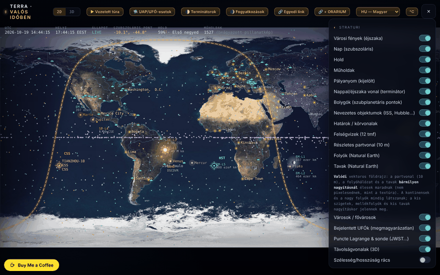

# Terra — a Föld valós időben

[English](README.md) · [Română](README.ro.md) · [Français](README.fr.md) · [Italiano](README.it.md) · [Español](README.es.md) · [Português](README.pt.md) · [Deutsch](README.de.md) · **Magyar**

**Verzió:** 2.0.0 · **Utolsó frissítés:** 2026-10-26

A felület nyelvei: **Română, English, Français, Italiano, Español, Português (PT), Deutsch, Magyar**

A Föld térképe és földgömbje a nappal/éjszaka határvonallal (terminátor), a Holddal, a bolygókkal, a műholdakkal és egy „Égbolt” móddal (planetárium), egyetlen HTML-fájlban.

**Online:** https://chiuta.github.io/TerRa/

## Mi ez

A Terra · valós idő (az oldal címe: „A Föld valós időben — Terminátor · Hold · Műholdak”) a böngészőben kiszámítja a Nap, a Hold, a bolygók és a műholdak helyzetét, és megjeleníti őket 2D térképen, 3D földgömbön vagy planetáriumnézetben („Égbolt”). A pályaadatok egy pillanatképe be van ágyazva a fájlba, így internet nélkül is működik; az élő adatfolyamok opcionálisak.

## Funkciók

- Módok: **2D**, **3D** és **Égbolt**, valamint vezetett túrák: „▶ Vezetett túra”, „🌓 Terminátorok”, „🌒 Fogyatkozások” és „🛸 UFO/UAP-esetek”.
- A nappal/éjszaka terminátor valós időben kiszámítva, városi fények az éjszakai oldalon, a szubszoláris pont, a szublunáris pont és a Hold fázisa.
- Időszabályozás: szünet/lejátszás, sebességek (1×, 60×, 600×, 3600×, 1 nap/mp), gyors ugrások (−7 n … +7 n, ±1 ó) és „Pontos időpont (helyi)”; „⦿ Vissza a mostra (élő)”.
- SGP4-gyel (alacsony pályák) és kepleri–J2 modellel (geostacionárius) propagált műholdak; kategóriák: űrállomások, szabad szemmel látható, Starlink, OneWeb, GPS, Galileo, GLONASS, BeiDou, tudományos, meteorológiai, Földmegfigyelés, geostacionárius; saját TLE betöltése (szöveg vagy fájl).
- A bolygók és a Plútó/Charon szubplanetáris pontokként; említésre méltó objektumok (ISS, Tiangong, Hubble), Lagrange-pontok és szondák (JWST, Gaia, Euclid, SOHO, DSCOVR); a jelentett UFO-k listája (beszámolókat dokumentál, nem állít földönkívüli eredetet).
- Rétegek: határok, felségvizek, részletes partvonal, folyók és tavak (Natural Earth), városok / fővárosok, szélességi/hosszúsági rács, procedurális fraktál domborzat, függőleges térkép mobilra.
- „Égbolt” mód: Tejútrendszer, Messier-objektumok, csillagképek, meteorrajok, ekliptika, megfigyelő a földről vagy más égitestekről; „Az égboltra mutatás (AR)” a telefon iránytűjével/giroszkópjával.
- Az ISS látható átvonulásai 48 órára, riasztással (rezgés + értesítés); felszíni környezet és egyensúlyi árapály a választott helyre.
- Opcionális élő adatfolyamok: repülőgépek (ADS-B), meteorológiai szondaballonok, időjárási radar, NOAA űridőjárás (Kp, napszél, röntgen, sarki fény ovális), USGS földrengések (24 óra), Movebank, GTFS-RT adatfolyam proxyn keresztül.
- Telefonon álló tájolásban: „⟳ Térkép elforgatása” gomb (függőleges / vízszintes térkép).
- Felület 8 nyelven: RO, EN, FR, IT, ES, PT, DE, HU (nyelvválasztó).
- Billentyűparancsok: `1` / `2` / `3` (2D / 3D / Égbolt), `Szóköz` (szünet / folytatás), `N` (vissza a „mostra”), `[` és `]` (3D perspektíva), `Esc`; mezőbe gépelés közben inaktívak. A „Névjegy” ablakban is le vannak írva.

## Az ORARIUM összes égiteste (1.4.0)

A TerRa mostantól megfigyelőként és célként is rendelkezik az [ORARIUM](https://chiuta.github.io/orarium/) mind a 45 égitestével: a Nap, a bolygók, a Hold, a holdak (köztük a most hozzáadott Phobos, Deimos, Hyperion és Charon), a törpebolygók és aszteroidák (Ceres, Vesta, Pallas, Hygiea, Psyche, Eros, Bennu, Ryugu, Haumea, Makemake, Eris) és a 67P üstökös. A Vénusz 50 km magasságú aerosztátja nem külön égitest: a Vénuszról hivatkozás vezet rá.

- Az aszteroidák és törpebolygók pályái valós JPL SBDB elemeket használnak; a Ceres, az Eros és az Eris egyezik a JPL Horizonsszal (≤ 0,007 CSE). A Bennu esetében a perihélium időpontját a JPL 2026-10-18-i efemeridájához igazították (a JPL-elemek epochája 2010). Az új holdak ugyanazt az egyszerűsített körpálya-modellt használják, mint a többi.
- A „🕰 Az idő más világokon” panel mind a 45 égitestet felsorolja, a Naptól mért szöggel és a „⚠ együttállás” jelzéssel, soronként három hivatkozással: ↗ a lap az ORARIUMban, 📡 az átviteli ablak a helyedről, 👁 az égbolt arról az égitestről, a TerRában.
- Fordítva, az ORARIUMban mind a 44 égitesthez van „↗ TerRa” (egy kommunikációs pár mindkét végét is beleértve).
- A helyi idő (0. délkör) csak a Holdhoz és a bolygókhoz jelenik meg; a holdak és aszteroidák idejét az ORARIUMban nézd meg.

## Kapcsolat az ORARIUMmal (1.3.0)

A TerRa és az [ORARIUM](https://chiuta.github.io/orarium/) (az idő minden világon) mindkét irányban össze van kapcsolva, egyedi hivatkozásokkal, hálózat és szerver nélkül:

- **A „🕰 Az idő más világokon” panel**: a helyi idő (0. délkör) a Holdon és a bolygókon az időskálán lévő időpontban, a következő dél és a következő éjfél, a Naptól mért szög és a „⚠ napegyüttállás” jelzés. A ↗ megnyitja az égitestet az ORARIUMban; a 📡 megnyitja az átviteli ablakot a „Saját helyem” pontról.
- **Az „Égbolt” mód egy másik égitestről**: a megfigyelő-választó alatt megjelenik az égitesten érvényes helyi idő (a holdak esetében: a Holdon érvényes napidő), hivatkozásokkal az égitest lapjára és az átviteli ablakra a helyedről.
- A **„Terminátorok”** és a **„Fogyatkozások”** túra: minden megállónál egy „↗ Az idő az égitesten / a Holdon az ORARIUMban” hivatkozás.
- **„🔗 + ORARIUM”**: két egyedi hivatkozást másol (a nézet a TerRában + a megfelelő idő/átvitel az ORARIUMban).
- A panel számításai ugyanazokat a képleteket használják, mint az ORARIUM (IAU-tájolások, egyszerűsített kepleri efemeridák; percnyi nagyságrendű pontosság), és azonos eredményt adnak.

## Egyedi hivatkozás (1.2.0)

A **„🔗 Egyedi hivatkozás”** gomb a jelenlegi nézet pontos címét másolja: a módot (2D / 3D / Égbolt), a megfigyelőt Égbolt módban (a Marsról, az Íóról…), az időpontot (UTC) és a helyet. Megnyitva a hivatkozás visszaállítja a nézetet, az idő a hivatkozásban szereplő időpontra rögzítve (szüneteltetve). A formátum egy címtöredék, szerver és hálózati kérések nélkül:

`#v=sky&o=mars&t=2026-10-18T15:00:00Z&ll=44.43,26.10`

- `v` = `2d` | `3d` | `sky`; `o` = a megfigyelő az „Égbolt” módban (pl. `mars`, `jupiter`, `io`, `luna`, `sun`, `ground`); `t` = az ISO-időpont UTC szerint; `ll` = szélesség,hosszúság.
- A hiányzó vagy érvénytelen paramétereket figyelmen kívül hagyja. Az [ORARIUM](https://chiuta.github.io/orarium/) is használja a „Megtekintés a TerRában” gombokhoz.

## Új funkciók (1.1.0)

A panel **„Helyi efemeridák”** szakasza (az összegző sor) és a **„Helyi efemeridák megnyitása”** ablak, helyben, hálózat nélkül, az `FFF.ephem` segítségével számítva, a „Saját helyem” és az időszabályozó időpontja (a szimulált időt is beleértve) alapján:

- **Összegzés** a panelen: Nap kelte/nyugta, a Hold fázisa és megvilágítása.
- **Ablak:** Nap (kelte, delelés, nyugta, nappalhossz, szürkületek), Hold (fázis, megvilágítás, kor, távolság, kelte/nyugta, következő fázisok) és egy táblázat a Nappal, a Holddal és a bolygókkal (előjeles ekliptikai hosszúság, magasság/azimut, kelte/nyugta, fényesség, elongáció).
- Az órák időzónája: alapértelmezés szerint a böngészőé, szerkeszthető (IANA-név).
- A megadott pontosság az ablakban található; az időpontok percre vannak kerekítve.
- A felület 8 nyelvű (RO, EN, FR, IT, ES, PT, DE, HU), a nyelvválasztóból választható. Az fr/it/es/pt/de/hu fordítások **automatikusak, és anyanyelvi beszélők nem ellenőrizték őket**.
- Amíg az ablak nyitva van, az alkalmazás billentyűparancsai (`1`/`2`/`3`/`Szóköz`/`N`) inaktívak; az `Esc` bezárja az ablakot.

## Használati útmutató

1. Nyisd meg az oldalt; a felső sávban válaszd a **2D**, **3D** vagy **Égbolt** módot.
2. Állítsd be a helyet a „Saját helyem” panelen („📍 Észlelés” gomb vagy kézi koordináták) az ISS-átvonulásokhoz, az árapályhoz és a földi nézethez.
3. Nyisd meg a ☰ menüt a „Rétegek” és a többi panel eléréséhez; jelöld be, amit látni szeretnél.
4. Az időt az alsó sávból szabályozd (szünet, sebesség, ugrások, „Pontos időpont”); a „⦿ Vissza a mostra (élő)” a jelenlegi időre tér vissza.
5. Húzással forgathatsz/mozgathatsz, görgetéssel vagy csíptetéssel nagyíthatsz; érints meg egy műholdat vagy jelölőt a részletekhez és a pályanyomhoz. 3D módban a `[` és `]` billentyű végigléptet a megfigyelési perspektívákon.
6. Friss adatokhoz: „⟲ Frissítés (online)” a műholdpanelen; a „↺ Vissza az offline pillanatképhez” visszaállítja a beágyazott adatokat.
7. Élő adatfolyamok: nyomd meg a „Lekérés …” gombokat a megfelelő paneleken (alapértelmezés szerint ki vannak kapcsolva).
8. A nyelvet az „EN”/„RO” gombbal válthatod.

## Adatvédelem és hálózat

- Az alkalmazás nem használ sütiket, és nincs benne analitika. A böngészőben csak a választott felületi nyelv marad meg (`localStorage`, kulcs: `terra.lang`); minden más helyben fut, és semmi más nem tárolódik.
- A te műveleteid nélkül az alkalmazás nem küld hálózati kéréseket. Amikor online funkciókat kapcsolsz be, a böngésző közvetlenül ezekkel veszi fel a kapcsolatot:
  - `celestrak.org` (műhold-TLE-k) és tartalékként `raw.githubusercontent.com` (CelesTrak-tükör);
  - `services.swpc.noaa.gov` (űridőjárás, sarki fény ovális) és `earthquake.usgs.gov` (földrengések);
  - `api.open-meteo.com` (aktuális időjárás a választott helyen);
  - `opendata.adsb.fi` és `api.adsb.lol` (repülőgépek a helyed körül, a koordináták a kérésben kerülnek elküldésre);
  - `api.v2.sondehub.org` (szondaballonok), `api.rainviewer.com` és `tilecache.rainviewer.com` (időjárási radar), `www.movebank.org` (állatadatok, nyilvános tanulmányok);
  - `corsproxy.io`, csak ha olyan források számára adsz meg/használsz CORS-proxyt, amelyek nem engedik a közvetlen hozzáférést; a proxy látja az adott kérést (az alkalmazás kifejezetten figyelmeztet erre).
- A helymeghatározást („📍 Észlelés”) csak gombnyomásra kéri; az ISS-riasztás értesítéseit csak akkor, ha bekapcsolod a riasztást.

- 1.1.0: a helyi efemeridák nem küldenek hálózati kéréseket és nem tárolnak semmit; a már beállított „Saját helyem” értéket használják (a „📍 Észlelés” helymeghatározás továbbra is kérésre történik, mint korábban). Az `fff-kit` kit (`core`, `label`, `bundle`, `ephem`) hozzáadja az átláthatóság gombot; induláskor nem ír semmit a `localStorage`-ba. A fent felsorolt online adatfolyamok nem változtak.
## Megjegyzés az UFO/UAP-esetekről

Az esetek listája beszámolókat dokumentál, és nem állít földönkívüli eredetet. A valós személyeknek (szemtanúknak, nyomozóknak, kutatóknak) tulajdonított állítások az idézett irodalomból származnak, és **nem lettek önállóan ellenőrizve**; a megjegyzés az oldalon is megjelenik („Jelentett UFO-k” panel és „Névjegy” szakasz, RO/EN). A lista jelenleg 94 esetet tartalmaz (az oldalon szereplő szöveg „több mint 70”-et mond, ami továbbra is igaz).

## Korlátok (új funkciók)

- **Helyi efemeridák — pontosság.** A JPL DE421/DE423-hoz képest: a Nap és a bolygók látszó helyzete ≤ 3″ (Neptunusz ≤ 5″, Plútó ≤ 7″), a Hold ≤ 1,5″; a Nap kelte/nyugta ≤ 6 mp, a Holdé ≤ 25 mp; a fázisok ≤ 30 mp. A pyephem 4.2.1-hez képest (teszt a `tests/` mappában): kelte/nyugta ≤ 0,5 mp, fázisok ≤ 6 mp, magasság/azimut ≤ 0,003°. Az időpontok percre vannak kerekítve. A valóságban a napkelte/napnyugta percekkel eltér (valós fénytörés, domborzat, magasság — nincs modellezve); a ΔT 2027-ben körülbelül ±1 mp bizonytalansággal bír. Navigációra nem alkalmas. A térkép/földgömb/égbolt meglévő számításait (terminátor, Hold, a nézetben lévő bolygók) nem cseréltük le és nem módosítottuk; a műholdak helyzete továbbra is a TLE-elemek korától függ.

## Tesztek

`node tests/fff-r8.test.mjs` (Playwright az `/opt/node-tools` mappából, helyi Chromium, letiltott hálózat; a `tests/_lib.mjs` tartalmazza a közös segédfüggvényeket). A hivatkozási értékek a `tests/ref-c3a.json` fájlban vannak: a kelte/nyugta/delelés időpontjai (Nap, Hold; 5 hely × 4 dátum), 56 fázisidőpont és 54 magasság/azimut pozíció, a **pyephem 4.2.1**-gyel függetlenül számítva (csak offline használva a számok előállításához; nem része az alkalmazásnak). Minden teszt küszöbértéke a kódban van megírva; a hozzáférhetőségi teszt (axe-core, `bypassCSP`) megnyitott párbeszédablakokban/paneleken is lefut, 1280×800 és 360×740 méretnél.

## Futtatás helyben / offline

Töltsd le az `index.html` fájlt, és nyisd meg a böngészőben. A Nap, a Hold, a bolygók helyzete, a terminátor, a fogyatkozások és a beágyazott pillanatkép műholdjai internet nélkül működnek; a TLE-frissítéshez és az élő adatfolyamokhoz internet szükséges.

## Licenc

MIT — lásd a LICENSE fájlt

## Audit

2026-10-10: a böngészőben ellenőrizve, hogy betöltéskor és nyugalmi állapotban nem indul hálózati kérés; kérések csak a fent leírt műveleteknél jelennek meg. Az oldalnak nem volt CSP-szabályzata; 2026-10-11-én hozzáadtak egyet, a `connect-src`/`img-src` `https:` értékre korlátozva (nem rögzített gazdagéplistára), mert a CORS-proxyt, a GTFS-RT címet és a BirdCast képet a felhasználó adja meg, és bármely HTTPS-tartományon lehetnek. A hozzáférhetőség javítva (nevek a kapcsolókhoz, nagyítás engedélyezve) funkcionális változtatás nélkül.

## Szerző

Alexio — Alexandru-Ionuț Chiuță. Kapcsolat: alexio@trom.tf

## Előzmények / Changelog
- **1.7.8 — 2026-10-22:** Szöveg és célpontok: legalább 12 px a kijelölő kártyákon (telemetriai értékek, címkék), a bemutató számlálóján, a billentyűtippeken és a lábjegyzeteken; az efemerisz-konzol hivatkozásai (↗ 📡 👁) legalább 24 px-esek (durva mutatónál 44 px). Újabb ellenőrzés 360 és 1366 px-en: nincs 24 px alatti célpont és 12 px alatti szöveg.

### 1.7.7 — 2026-10-22

fff-kit 1.1.4: érintési célok és minimális szövegméret; érintési célok és szöveg javítva.

### 1.7.6 — 2026-10-22
- fff-kit 1.1.2: PBKDF2 600 000 iterációval, clickjacking elleni védelem

### 1.7.5 — 2026-10-22
- Mobil: a szöveg legalább 12 px, a gombok és mezők érintési felülete pedig nagyobb keskeny képernyőn.
- Akadálymentesség: a TLE-beillesztő mező, az élő adatforrások mezői (GTFS-RT, Movebank, BirdCast, CORS-proxy) és a szélességi/hosszúsági mezők mostantól a képernyőolvasók által felolvasott névvel rendelkeznek (8 nyelv).
- Keskeny képernyőn a lebegő „Buy Me a Coffee” gomb el van rejtve, amíg a vezérlőpanel nyitva van, így már nem takarja el a panel szövegét.

- 1.7.4 — 2026-10-22: **javítás**: a bolygók nevei, a Hubble-bejegyzés, a „Gyors ugrás” és a „Pontos időpont (helyi)” feliratok, valamint az UFO-kártya címkéje mostantól a felület nyelvét követik; a bolygók, a nevezetes objektumok és a Lagrange-pontok listája nyelvváltáskor újraépül.
### 2026. október 22. (v1.7.3)
- Javítva a nappal/éjszaka widget („Idő az égitesten”): a Föld sora már nem mutat „Naptól mért szög NaN°” értéket, sem abszurd percszámot a dél/éjfél eléréséig (a Föld napi periódusa hiányzott a periódustáblából, és a Naptól mért szöget a Földre önmagához képest számolta).
- Felület: az útmutató bekezdései, a „Saját TLE betöltése” szakasz, az árapály-címkék, az esetek feliratai („beszámolók”, „1981-ből”), a műholdkategóriák jelmagyarázata, az „Előre/Vissza” gombok, valamint az oldal címe és leírása mostantól mind a 8 nyelven követi a felület nyelvét.

### 2026. október 21. (v1.7.2)
- A Valea Plopului kártya és túralépés szövege átfogalmazva és forrásmegjelöléssel ellátva: „a beszámolók szerint … az idézett források az első igazolt és szakértőileg vizsgált esetként mutatják be … függetlenül nem ellenőrzött; az eset vitatott marad” (már nem tényként szerepel); a dátum „1972 szeptember”, a helység „Poșești”, a Justin Capră-nak tulajdonított mérés „a beszámolók szerint”. A túra felirata mostantól fr/it/es/pt/de/hu nyelven is le van fordítva (korábban angolra esett vissza). A Valea Plopului-szöveg egységes a ValeaPlopului1972-vel; `tests/vp-case.test.mjs` teszt.

### 2026. október 19. (v1.6.0)
- Új: „↗ Bolta” Égbolt módban (a földről): ugyanaz az időpont és ugyanaz a hely a Bolta offline planetáriumban; t= nélkül, ha az idő „most”, az 1900–2100 tartományon kívül rejtve.
- Adatvédelem: a GPS-ből vett helyet ~1 km-re kerekíti az ORARIUM és a Bolta felé mutató hivatkozásokban.
- „← vissza” az ECLIPSA, az Eclipsa 2027, a Horoscop, a Field Observer és a Horizons forrásokhoz.
- A „← vissza” gombot már nem takarja el a Buy Me a Coffee widget (balra lent): felette helyezkedik el.
- Diszkrét figyelmeztetés: „Csökkent pontosság 2100 után: a ΔT extrapolált, a Plútó nem elérhető.” (ro/en, hu/de az en-en keresztül) csak akkor, ha a szimulált vagy a `t=` szerinti dátum meghaladja a 2100-at.

### 2026. október 18. (v1.5.0)
- Új: az `ufo=<eset>` paraméter (pl. `#v=2d&ufo=valea-plopului`) a 2D térképet az UFO-lista esetére középre állítja és megnyitja a kártyát, a „Saját helyem” módosítása nélkül; az ismeretlen értékeket figyelmen kívül hagyja. A `from=valeaplopului` a „← vissza” gombot jeleníti meg a ValeaPlopului1972 felé. Az eset szövege nem módosult.

### 2026. október 18. (v1.4.0)
- Új: az ORARIUM mind a 45 égiteste, 15 hozzáadott égitesttel (Phobos, Deimos, Hyperion, Charon, Ceres, Vesta, Pallas, Hygiea, Psyche, Eros, Bennu, Ryugu, Haumea, Makemake, Eris) megfigyelőként és célként; az ORARIUM panel felsorolja az összes égitestet, mindkét irányú hivatkozásokkal.

### 2026. október 18. (v1.3.0)
- Új: a kapcsolat az ORARIUMmal („Az idő más világokon” panel, szalag Égbolt módban, hivatkozások a túrákban, kombinált „🔗 + ORARIUM” hivatkozás).

### 2026. október 18. (v1.2.0)
- Új: egyedi hivatkozás (URL-töredék) a módhoz, a megfigyelőhöz, az időponthoz és a helyhez, valamint a „🔗 Egyedi hivatkozás” gomb; kapcsolat az ORARIUMmal.

### 2026. október 14. (v1.1.0)
- Új: „Helyi efemeridák” (összegző sor a panelen + felugró ablak: Nap, Hold, fázisok, bolygók, szürkületek, szerkeszthető időzóna, megadott pontosság); RO/EN/HU/DE nyelvi ciklus az új funkciókhoz; az `fff-kit` kit (`core`, `label`, `bundle`, `ephem`); `tests/fff-r8.test.mjs` (51 ellenőrzés, köztük axe világos és sötét témában, 1280×800 és 360×740 méretnél, megnyitott ablakkal). Előtte/utána összehasonlítás 1280×800 méretnél: a képpontok 0,05%-ánál kisebb eltérés (animációs/WebGL-zaj), a képernyőkép nem változott; az új szakasz a vezérlőpanelen található.

### 2026. október 12. (v1.0.0)
- 1.0.0 — 2026-10-12: a verzió és az utolsó frissítés dátuma megjelenik az alkalmazásban

### 2026. október 11.
- Javítva (régi HTML-szerkezeti hiba): egy felesleges `
` idő előtt lezárta a vezérlőpanelt, így kilenc szakasz (Holdfázis, Bolygók, Saját helyem, Felszíni környezet, Árapály stb.) kiesett a panelből és nem lehetett elérni őket; most mind a 19 szakasz a panelben van, az időszabályozó címe pedig „Idő — múlt / jövő”.
- „Saját helyem”: a tizedesvessző elfogadott (`44,43`), a tartományon kívüli koordináták hibaüzenetet adnak a csendes levágás helyett.
- „⟳ Térkép elforgatása” gomb a fejlécben (csak 2D módban, keskeny, álló tájolású képernyőn) a függőleges és a vízszintes térkép közötti gyors váltáshoz; a feliratok vízszintes tájolásban is olvashatók maradnak.
- Billentyűparancsok (1/2/3, Szóköz, N), EN fordítással a „Névjegy” ablakban.
- A 2D térkép feliratai (állomások, bolygók, Lagrange-pontok, szondák, Nap, Hold, említésre méltó objektumok) már nem fedik egymást: függőlegesen eltolódnak vagy kimaradnak.
- CSP: `script-src` SHA-256 hash alapján a két szkripthez, `'unsafe-inline'` nélkül (a kapcsolatok továbbra is `https:`).
- Álló tájolású telefonokon a 2D térkép mostantól „Függőleges térkép” módban indul (kitölti a képernyőt, a feliratok jobban olvashatók); a felső sáv félig átlátszó hátteret kapott.
- Az „Adatforrás (TLE)” panel figyelmeztet, ha a beágyazott pályaelemek régiek (>7 nap; 2026. 10. 11-én a pillanatkép ~107 napos, mediánepocha 2026-06-26): a műholdak helyzete a „Frissítés (online)”-ig közelítő.
- A tartalom `<main>` elembe van foglalva (axe: 0 hiba); CSP hozzáadva (`default-src 'none'`, külső szkriptek nélkül, a kapcsolatokhoz csak `https:`).
- Megoldatlan: a 2,1 MB méret (JPEG textúrák + beágyazott Natural Earth adatok); a képek újratömörítése csak ~5%-ot nyerne látható veszteséggel.
