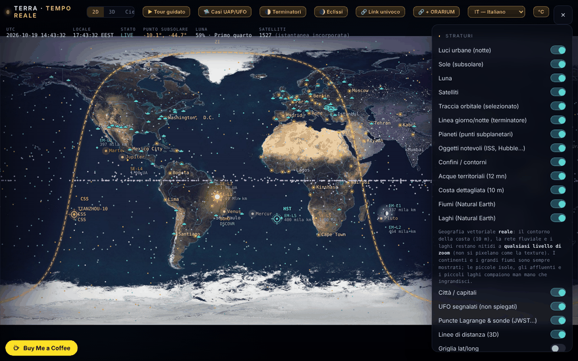

# Terra — la Terra in tempo reale

[English](README.md) · [Română](README.ro.md) · [Français](README.fr.md) · **Italiano** · [Español](README.es.md) · [Português](README.pt.md) · [Deutsch](README.de.md) · [Magyar](README.hu.md)

**Versione:** 1.7.10 · **Ultimo aggiornamento:** 2026-10-26

Lingue dell'interfaccia: **Română, English, Français, Italiano, Español, Português (PT), Deutsch, Magyar**

Mappa e globo della Terra con il terminatore giorno/notte, la Luna, i pianeti, i satelliti e una modalità «Cielo» (planetario), in un unico file HTML.

**Online:** https://chiuta.github.io/TerRa/

## Che cos'è

Terra · tempo reale (titolo della pagina: «La Terra in tempo reale — Terminatore · Luna · Satelliti») calcola nel browser la posizione del Sole, della Luna, dei pianeti e dei satelliti e li mostra su una mappa 2D, su un globo 3D o in una vista da planetario («Cielo»). Un'istantanea di dati orbitali è incorporata nel file, quindi funziona anche senza internet; i feed in diretta sono facoltativi.

## Funzioni

- Modalità: **2D**, **3D** e **Cielo**, più visite guidate: «▶ Visita guidata», «🌓 Terminatori», «🌒 Eclissi» e «🛸 Casi UFO/UAP».
- Il terminatore giorno/notte calcolato in tempo reale, le luci delle città sul lato notturno, il punto subsolare, il punto sublunare e la fase della Luna.
- Controllo del tempo: pausa/riproduzione, velocità (1×, 60×, 600×, 3600×, 1 giorno/s), salti rapidi (−7g … +7g, ±1h) e «Momento esatto (locale)»; «⦿ Torna ad adesso (diretta)».
- Satelliti propagati con SGP4 (orbite basse) e un modello kepleriano-J2 (geostazionari); categorie: stazioni spaziali, visibili a occhio nudo, Starlink, OneWeb, GPS, Galileo, GLONASS, BeiDou, scientifici, meteo, osservazione della Terra, geostazionari; caricamento di TLE propri (testo o file).
- Pianeti e Plutone/Caronte come punti subplanetari; oggetti notevoli (ISS, Tiangong, Hubble), punti di Lagrange e sonde (JWST, Gaia, Euclid, SOHO, DSCOVR); elenco di UFO segnalati (documenta resoconti, non afferma un'origine extraterrestre).
- Livelli: confini, acque territoriali, costa dettagliata, fiumi e laghi (Natural Earth), città / capitali, griglia lat/long, rilievo frattale procedurale, mappa verticale per dispositivi mobili.
- Modalità «Cielo»: Via Lattea, oggetti Messier, costellazioni, sciami meteorici, eclittica, osservatore da terra o da altri corpi; «Punta verso il cielo (AR)» con la bussola/il giroscopio del telefono.
- Passaggi visibili della ISS nelle 48 h, con allarme (vibrazione + notifica); ambiente di superficie e maree di equilibrio per la località scelta.
- Feed in diretta facoltativi: aerei (ADS-B), palloni sonda meteo, radar meteo, meteo spaziale NOAA (Kp, vento solare, raggi X, ovale aurorale), terremoti USGS (24 h), Movebank, flusso GTFS-RT tramite proxy.
- Su telefono in verticale: pulsante «⟳ Ruota la mappa» (mappa verticale / orizzontale).
- Interfaccia in 8 lingue: RO, EN, FR, IT, ES, PT, DE, HU (selettore di lingua).
- Scorciatoie da tastiera: `1` / `2` / `3` (2D / 3D / Cielo), `Spazio` (pausa / ripresa), `N` (ritorno ad «adesso»), `[` e `]` (prospettiva 3D), `Esc`; inattive mentre si scrive in un campo. Sono descritte anche nella finestra «Informazioni».

## Tutti i corpi di ORARIUM (1.4.0)

TerRa ha ora come osservatore e come bersaglio ciascuno dei 45 corpi di [ORARIUM](https://chiuta.github.io/orarium/): il Sole, i pianeti, la Luna, i satelliti (inclusi Phobos, Deimos, Hyperion e Caronte, aggiunti ora), i pianeti nani e gli asteroidi (Cerere, Vesta, Pallade, Igea, Psiche, Eros, Bennu, Ryugu, Haumea, Makemake, Eris) e la cometa 67P. L'aerostato di Venere a 50 km non è un corpo separato: ha un link da Venere.

- Le orbite degli asteroidi e dei pianeti nani usano elementi reali JPL SBDB; Cerere, Eros ed Eris coincidono con JPL Horizons (≤ 0,007 UA). Per Bennu, l'istante del perielio è regolato sull'effemeride JPL del 2026-10-18 (gli elementi JPL hanno epoca 2010). I nuovi satelliti usano lo stesso modello circolare semplificato degli altri.
- Il pannello «🕰 L'ora su altri mondi» elenca tutti i 45 corpi, con l'angolo rispetto al Sole e «⚠ congiunzione», e tre link per riga: ↗ la scheda in ORARIUM, 📡 la finestra di trasmissione dalla tua posizione, 👁 il cielo da quel corpo, in TerRa.
- Viceversa, ORARIUM ha «↗ TerRa» per tutti i 44 corpi (compresa ciascuna estremità di una coppia di comunicazione).
- L'ora locale (meridiano 0) compare solo per la Luna e i pianeti; per i satelliti e gli asteroidi vedi l'ora in ORARIUM.

## Il collegamento con ORARIUM (1.3.0)

TerRa e [ORARIUM](https://chiuta.github.io/orarium/) (l'ora su tutti i mondi) sono collegati in entrambe le direzioni, tramite link univoci, senza rete e senza server:

- **Il pannello «🕰 L'ora su altri mondi»**: l'ora locale (meridiano 0) sulla Luna e sui pianeti nell'istante della barra del tempo, il prossimo mezzogiorno e la prossima mezzanotte, l'angolo rispetto al Sole e il segnale «⚠ congiunzione solare». ↗ apre il corpo in ORARIUM; 📡 apre la finestra di trasmissione da «La mia posizione».
- **La modalità «Cielo» da un altro corpo**: sotto il selettore dell'osservatore compare l'ora locale sul corpo (per i satelliti lunari: l'ora solare sulla Luna), con link alla scheda del corpo e alla finestra di trasmissione dalla tua posizione.
- Le visite **«Terminatori»** ed **«Eclissi»**: a ogni tappa, un link «↗ L'ora sul corpo / sulla Luna in ORARIUM».
- **«🔗 + ORARIUM»**: copia due link univoci (la vista in TerRa + l'ora/la trasmissione corrispondente in ORARIUM).
- I calcoli nel pannello usano le stesse formule di ORARIUM (orientamenti IAU, effemeridi kepleriane semplificate; precisione dell'ordine dei minuti) e danno risultati identici.

## Link univoco (1.2.0)

Il pulsante **«🔗 Link univoco»** copia l'indirizzo esatto della vista corrente: la modalità (2D / 3D / Cielo), l'osservatore in modalità Cielo (da Marte, da Io…), l'istante (UTC) e la posizione. Una volta aperto, il link ripristina la vista, con il tempo fissato (in pausa) all'istante indicato nel link. Il formato è un frammento di indirizzo, senza server e senza richieste di rete:

`#v=sky&o=mars&t=2026-10-18T15:00:00Z&ll=44.43,26.10`

- `v` = `2d` | `3d` | `sky`; `o` = l'osservatore in «Cielo» (es. `mars`, `jupiter`, `io`, `luna`, `sun`, `ground`); `t` = l'istante ISO in UTC; `ll` = latitudine,longitudine.
- I parametri mancanti o non validi vengono ignorati. Usato anche da [ORARIUM](https://chiuta.github.io/orarium/) per i pulsanti «Vedi in TerRa».

## Nuove funzioni (1.1.0)

La sezione **«Effemeridi locali»** del pannello (la riga di riepilogo) e la finestra **«Apri le effemeridi locali»**, calcolate localmente, senza rete, con `FFF.ephem`, per «La mia posizione» e l'istante del controllo del tempo (compreso il tempo simulato):

- **Riepilogo** nel pannello: alba/tramonto del Sole, fase della Luna e illuminazione.
- **Finestra:** Sole (alba, transito, tramonto, durata del giorno, crepuscoli), Luna (fase, illuminazione, età, distanza, sorgere/tramonto, prossime fasi) e una tabella con Sole, Luna e pianeti (longitudine eclittica con segno, altezza/azimut, sorgere/tramonto, magnitudine, elongazione).
- Il fuso orario per le ore: quello del browser per impostazione predefinita, modificabile (nome IANA).
- La precisione dichiarata è nella finestra; gli orari sono arrotondati al minuto.
- L'interfaccia ha 8 lingue (RO, EN, FR, IT, ES, PT, DE, HU), scelte dal selettore di lingua. Le traduzioni fr/it/es/pt/de/hu sono **automatiche e non verificate da madrelingua**.
- Finché la finestra è aperta, le scorciatoie da tastiera dell'applicazione (`1`/`2`/`3`/`Spazio`/`N`) sono inattive; `Esc` chiude la finestra.

## Manuale d'uso

1. Apri la pagina; scegli **2D**, **3D** o **Cielo** dalla barra superiore.
2. Imposta la posizione nel pannello «La mia posizione» (pulsante «📍 Rileva» o coordinate manuali) per i passaggi della ISS, le maree e la vista da terra.
3. Apri ☰ per «Livelli» e gli altri pannelli; spunta ciò che vuoi vedere.
4. Controlla il tempo dalla barra inferiore (pausa, velocità, salti, «Momento esatto»); «⦿ Torna ad adesso (diretta)» riporta all'ora corrente.
5. Trascina per ruotare/spostare, scorri o pizzica per ingrandire; tocca un satellite o un indicatore per i dettagli e la traccia orbitale. In modalità 3D, i tasti `[` e `]` scorrono le prospettive di osservazione.
6. Per dati attuali: «⟲ Aggiorna (online)» nel pannello dei satelliti; «↺ Torna all'istantanea offline» ripristina i dati incorporati.
7. Feed in diretta: premi i pulsanti «Recupera …» nei rispettivi pannelli (sono disattivati per impostazione predefinita).
8. Cambia la lingua con il pulsante «EN»/«RO».

## Privacy e rete

- L'applicazione non usa cookie e non ha analytics. L'unica cosa conservata nel browser è la lingua scelta dell'interfaccia (`localStorage`, chiave `terra.lang`); il resto gira in locale e non viene memorizzato altro.
- Senza le tue azioni, l'applicazione non effettua richieste di rete. Quando attivi funzioni online, il browser contatta direttamente:
  - `celestrak.org` (TLE dei satelliti) e, come riserva, `raw.githubusercontent.com` (mirror di CelesTrak);
  - `services.swpc.noaa.gov` (meteo spaziale, ovale aurorale) e `earthquake.usgs.gov` (terremoti);
  - `api.open-meteo.com` (meteo attuale nella località scelta);
  - `opendata.adsb.fi` e `api.adsb.lol` (aerei intorno alla tua posizione, le coordinate sono inviate nella richiesta);
  - `api.v2.sondehub.org` (palloni sonda), `api.rainviewer.com` e `tilecache.rainviewer.com` (radar meteo), `www.movebank.org` (dati sugli animali, studi pubblici);
  - `corsproxy.io`, solo se inserisci/usi un proxy CORS per fonti che non consentono l'accesso diretto; il proxy vede quella richiesta (l'applicazione avverte esplicitamente).
- La geolocalizzazione («📍 Rileva») viene richiesta solo alla pressione; le notifiche per l'allarme ISS solo se attivi l'allarme.

- 1.1.0: le effemeridi locali non effettuano richieste di rete e non memorizzano nulla; usano «La mia posizione» già impostata (la geolocalizzazione «📍 Rileva» resta su richiesta, come prima). Il kit `fff-kit` (`core`, `label`, `bundle`, `ephem`) aggiunge il pulsante di trasparenza; all'avvio non scrive nulla in `localStorage`. I feed online elencati sopra non sono cambiati.
## Nota sui casi UFO/UAP

L'elenco dei casi documenta resoconti e non afferma un'origine extraterrestre. Le affermazioni attribuite a persone reali (testimoni, investigatori, ricercatori) sono riportate dalla letteratura citata e **non sono state verificate in modo indipendente**; la nota compare anche nella pagina (pannello «UFO segnalati» e sezione «Informazioni», RO/EN). L'elenco contiene attualmente 94 casi (il testo nella pagina dice «oltre 70», il che resta vero).

## Limiti (nuove funzioni)

- **Effemeridi locali — precisione.** Rispetto a JPL DE421/DE423: posizioni apparenti del Sole e dei pianeti ≤ 3″ (Nettuno ≤ 5″, Plutone ≤ 7″), Luna ≤ 1,5″; alba/tramonto del Sole ≤ 6 s, della Luna ≤ 25 s; fasi ≤ 30 s. Rispetto a pyephem 4.2.1 (test in `tests/`): sorgere/tramonto ≤ 0,5 s, fasi ≤ 6 s, alt/az ≤ 0,003°. Gli orari sono arrotondati al minuto. In realtà alba e tramonto differiscono di minuti (rifrazione reale, rilievo, altitudine — non modellati); ΔT è incerto di circa ±1 s nel 2027. Non adatto alla navigazione. I calcoli esistenti di mappa/globo/cielo (terminatore, Luna, pianeti in vista) non sono stati sostituiti né modificati; la posizione dei satelliti resta dipendente dall'età degli elementi TLE.

## Test

`node tests/fff-r8.test.mjs` (Playwright da `/opt/node-tools`, Chromium locale, rete bloccata; `tests/_lib.mjs` contiene le utilità comuni). I valori di riferimento sono in `tests/ref-c3a.json`: gli istanti di sorgere/tramonto/transito (Sole, Luna; 5 luoghi × 4 date), 56 istanti di fase e 54 posizioni alt/az, calcolati in modo indipendente con **pyephem 4.2.1** (usato solo offline per generare i numeri; non fa parte dell'applicazione). Ogni test ha la soglia scritta nel codice; il test di accessibilità (axe-core, `bypassCSP`) viene eseguito anche in finestre di dialogo/pannelli aperti, a 1280×800 e 360×740.

## Esecuzione locale / offline

Scarica `index.html` e aprilo nel browser. La posizione del Sole, della Luna, dei pianeti, il terminatore, le eclissi e i satelliti dell'istantanea incorporata funzionano senza internet; l'aggiornamento dei TLE e i feed in diretta richiedono internet.

## Licenza

MIT — vedi il file LICENSE

## Audit

2026-10-10: verificato nel browser che al caricamento e a riposo non parte alcuna richiesta di rete; le richieste compaiono solo con le azioni descritte sopra. La pagina non aveva una policy CSP; il 2026-10-11 ne è stata aggiunta una, con `connect-src`/`img-src` limitati a `https:` (e non a un elenco fisso di host), perché il proxy CORS, l'indirizzo GTFS-RT e l'immagine BirdCast sono inseriti dall'utente e possono trovarsi su qualsiasi dominio HTTPS. Corretta l'accessibilità (nomi per gli interruttori, zoom consentito) senza modifiche funzionali.

## Autore

Alexio — Alexandru-Ionuț Chiuță. Contatto: alexio@trom.tf

## Cronologia / Changelog
- **1.7.8 — 2026-10-22:** Testo e bersagli: minimo 12 px nelle schede di selezione (valori di telemetria, etichette), nel contatore del tour, nei suggerimenti da tastiera e nelle note a piè di pagina; i link della console delle effemeridi (↗ 📡 👁) sono di almeno 24 px (44 px su puntatore grossolano). Nuovo audit a 360 e 1366 px: nessun bersaglio sotto 24 px né testo sotto 12 px.

### 1.7.7 — 2026-10-22

fff-kit 1.1.4: target touch e dimensione minima del testo; target touch e testo corretti.

### 1.7.6 — 2026-10-22
- fff-kit 1.1.2: PBKDF2 con 600.000 iterazioni, protezione anti-clickjacking

### 1.7.5 — 2026-10-22
- Mobile: il testo è di almeno 12 px e pulsanti e campi hanno aree tattili più grandi sugli schermi stretti.
- Accessibilità: la casella di incolla TLE, i campi dei feed in tempo reale (GTFS-RT, Movebank, BirdCast, proxy CORS) e i campi latitudine/longitudine hanno ora un nome annunciato dagli screen reader (8 lingue).
- Sugli schermi stretti il pulsante flottante «Buy Me a Coffee» è nascosto finché il pannello dei comandi è aperto, quindi non copre più il testo del pannello.

- 1.7.4 — 2026-10-22: **correzione**: i nomi dei pianeti, la voce Hubble, le etichette «Salto rapido» e «Momento esatto (locale)» e l’etichetta della scheda UFO seguono ora la lingua dell’interfaccia; gli elenchi di pianeti, oggetti notevoli e punti di Lagrange vengono ricostruiti al cambio di lingua.
### 22 ottobre 2026 (v1.7.3)
- Corretto il widget giorno/notte («Ora sul corpo»): la riga Terra non mostra più «angolo dal Sole NaN°» né un numero assurdo di minuti a mezzogiorno/mezzanotte (mancava il giorno solare della Terra nella tabella dei periodi e l'angolo dal Sole era calcolato per la Terra rispetto a se stessa).
- Interfaccia: i paragrafi della guida, la sezione «Carica il tuo TLE», le etichette delle maree, le didascalie dei casi («segnalazioni», «del 1981»), la legenda delle categorie di satelliti, i pulsanti «Avanti/Indietro» e il titolo/la descrizione della pagina seguono ora la lingua dell'interfaccia in tutte le 8 lingue.

### 21 ottobre 2026 (v1.7.2)
- La scheda e il passo del tour su Valea Plopului sono stati riformulati e attribuiti: «secondo i resoconti … presentato nelle fonti citate come il primo caso attestato e sottoposto a perizia … non verificato in modo indipendente; il caso resta controverso» (non è più affermato come fatto); la data è «settembre 1972», la località «Poșești», la misurazione attribuita a Justin Capră «secondo i resoconti». La didascalia del tour è ora tradotta in fr/it/es/pt/de/hu (prima ricadeva sull'inglese). Il testo su Valea Plopului è allineato con ValeaPlopului1972; test `tests/vp-case.test.mjs`.

### 19 ottobre 2026 (v1.6.0)
- Novità: «↗ Bolta» in modalità Cielo (da terra): stesso istante e stessa posizione nel planetario offline Bolta; senza t= quando l'ora è «adesso», nascosto fuori dal 1900–2100.
- Privacy: una posizione ottenuta dal GPS viene arrotondata a ~1 km nei link verso ORARIUM e Bolta.
- «← indietro» per le fonti ECLIPSA, Eclipsa 2027, Horoscop, Field Observer, Horizons.
- Il pulsante «← indietro» non è più coperto dal widget Buy Me a Coffee (in basso a sinistra): sta sopra di esso.
- Un avviso discreto «Precisione ridotta dopo il 2100: ΔT estrapolato, Plutone non disponibile.» (ro/en, hu/de tramite en) solo quando la data simulata o quella di `t=` supera il 2100.

### 18 ottobre 2026 (v1.5.0)
- Novità: il parametro `ufo=<caso>` (es. `#v=2d&ufo=valea-plopului`) centra la mappa 2D sul caso dell'elenco UFO e apre la scheda, senza cambiare «La mia posizione»; i valori sconosciuti vengono ignorati. `from=valeaplopului` mostra il pulsante «← indietro» verso ValeaPlopului1972. Il testo del caso non è stato modificato.

### 18 ottobre 2026 (v1.4.0)
- Novità: tutti i 45 corpi di ORARIUM, con 15 corpi aggiunti (Phobos, Deimos, Hyperion, Caronte, Cerere, Vesta, Pallade, Igea, Psiche, Eros, Bennu, Ryugu, Haumea, Makemake, Eris) come osservatori e bersagli; il pannello ORARIUM elenca tutti i corpi, con link in entrambe le direzioni.

### 18 ottobre 2026 (v1.3.0)
- Novità: il collegamento con ORARIUM (pannello «L'ora su altri mondi», banner in modalità Cielo, link nelle visite, link combinato «🔗 + ORARIUM»).

### 18 ottobre 2026 (v1.2.0)
- Novità: link univoco (frammento URL) per modalità, osservatore, istante e posizione, più il pulsante «🔗 Link univoco»; collegamento con ORARIUM.

### 14 ottobre 2026 (v1.1.0)
- Novità: «Effemeridi locali» (riga di riepilogo nel pannello + finestra modale: Sole, Luna, fasi, pianeti, crepuscoli, fuso orario modificabile, precisione dichiarata); ciclo di lingue RO/EN/HU/DE per le nuove funzioni; il kit `fff-kit` (`core`, `label`, `bundle`, `ephem`); `tests/fff-r8.test.mjs` (51 verifiche, compreso axe nei temi chiaro e scuro, a 1280×800 e 360×740, con la finestra aperta). Confronto prima/dopo a 1280×800: differenze inferiori allo 0,05% dei pixel (rumore di animazione/WebGL), la schermata non è cambiata; la nuova sezione è nel pannello dei comandi.

### 12 ottobre 2026 (v1.0.0)
- 1.0.0 — 2026-10-12: la versione e la data dell'ultimo aggiornamento sono mostrate nell'applicazione

### 11 ottobre 2026
- Corretto (vecchio difetto della struttura HTML): un `
` di troppo chiudeva prematuramente il pannello dei comandi, per cui nove sezioni (Fase della Luna, Pianeti, La mia posizione, Ambiente di superficie, Maree, ecc.) uscivano dal pannello e non potevano essere raggiunte; ora tutte le 19 sezioni sono nel pannello, e il controllo del tempo ha il titolo «Tempo — passato / futuro».
- «La mia posizione»: la virgola decimale è accettata (`44,43`), e le coordinate fuori intervallo producono un messaggio di errore invece di essere troncate in silenzio.
- Pulsante «⟳ Ruota la mappa» nell'intestazione (solo in 2D, su schermo stretto in verticale) per passare rapidamente tra la mappa verticale e quella orizzontale; le etichette restano leggibili in orientamento orizzontale.
- Scorciatoie da tastiera (1/2/3, Spazio, N), con traduzione EN nella finestra «Informazioni».
- Le etichette nella mappa 2D (stazioni, pianeti, punti di Lagrange, sonde, Sole, Luna, oggetti notevoli) non si sovrappongono più: vengono spostate in verticale o omesse.
- CSP: `script-src` tramite hash SHA-256 per i due script, senza `'unsafe-inline'` (le connessioni restano `https:`).
- Sui telefoni in verticale la mappa 2D parte ora in modalità «Mappa verticale» (riempie lo schermo, le etichette sono più leggibili); la barra superiore ha uno sfondo semitrasparente.
- Il pannello «Fonte dei dati (TLE)» avverte quando gli elementi orbitali incorporati sono vecchi (>7 giorni; all'11.10.2026 l'istantanea ha ~107 giorni, epoca mediana 2026-06-26): le posizioni dei satelliti sono approssimative fino a «Aggiorna (online)».
- Il contenuto è racchiuso in `<main>` (axe: 0 violazioni); aggiunta una CSP (`default-src 'none'`, nessuno script esterno, solo `https:` per le connessioni).
- Non risolto: la dimensione di 2,1 MB (texture JPEG + dati Natural Earth incorporati); ricomprimere le immagini farebbe guadagnare solo ~5% con perdita visibile.
