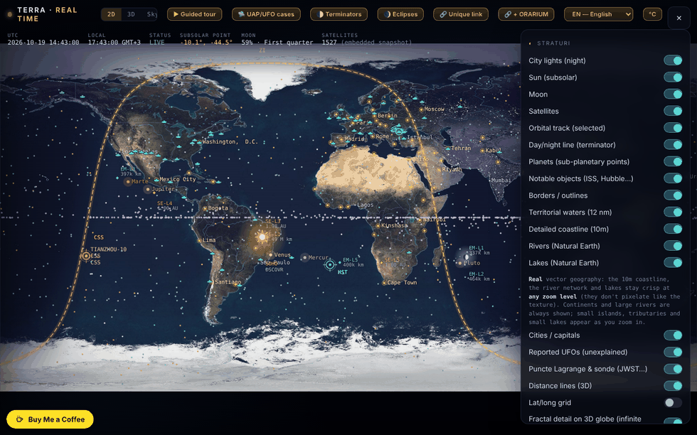

# Terra — the Earth in real time

**English** · [Română](README.ro.md) · [Français](README.fr.md) · [Italiano](README.it.md) · [Español](README.es.md) · [Português](README.pt.md) · [Deutsch](README.de.md) · [Magyar](README.hu.md)

**Version:** 1.7.8 · **Last updated:** 2026-10-22

Interface languages: **Română, English, Français, Italiano, Español, Português (PT), Deutsch, Magyar**

A map and globe of the Earth with the day/night terminator, the Moon, the planets, satellites and a "Sky" mode (planetarium), in a single HTML file.

**Live:** https://chiuta.github.io/TerRa/

## What it is

Terra · real time (the page title: "The Earth in real time — Terminator · Moon · Satellites") computes in the browser the position of the Sun, the Moon, the planets and the satellites and displays them on a 2D map, on a 3D globe or in a planetarium view ("Sky"). A snapshot of orbital data is embedded in the file, so it also works without internet; the live feeds are optional.

## Features

- Modes: **2D**, **3D** and **Sky**, plus guided tours: "▶ Guided tour", "🌓 Terminators", "🌒 Eclipses" and "🛸 UAP/UFO cases".
- The day/night terminator computed in real time, city lights on the night side, the subsolar point, the sublunar point and the phase of the Moon.
- Time control: pause/play, speeds (1×, 60×, 600×, 3600×, 1 day/s), quick jumps (−7d … +7d, ±1h) and "Exact moment (local)"; "⦿ Back to now (live)".
- Satellites propagated with SGP4 (low orbits) and a Keplerian-J2 model (geostationary); categories: space stations, visible to the naked eye, Starlink, OneWeb, GPS, Galileo, GLONASS, BeiDou, scientific, weather, Earth observation, geostationary; loading of your own TLE (text or file).
- Planets and Pluto/Charon as sub-planetary points; notable objects (ISS, Tiangong, Hubble), Lagrange points and probes (JWST, Gaia, Euclid, SOHO, DSCOVR); a list of reported UFOs (it documents accounts, it does not assert an extraterrestrial origin).
- Layers: borders, territorial waters, detailed coastline, rivers and lakes (Natural Earth), cities / capitals, lat/long grid, procedural fractal relief, vertical map for mobile.
- "Sky" mode: the Milky Way, Messier objects, constellations, meteor showers, the ecliptic, an observer on the ground or on other bodies; "Point at the sky (AR)" with the phone's compass/gyroscope.
- Visible ISS passes over 48 h, with an alert (vibration + notification); surface environment and equilibrium tides for the chosen location.
- Optional live feeds: aircraft (ADS-B), weather radiosonde balloons, weather radar, NOAA space weather (Kp, solar wind, X-rays, auroral oval), USGS earthquakes (24 h), Movebank, a GTFS-RT feed via a proxy.
- On a phone in portrait: a "⟳ Rotate the map" button (vertical / horizontal map).
- Interface in 8 languages: RO, EN, FR, IT, ES, PT, DE, HU (language selector).
- Keyboard shortcuts: `1` / `2` / `3` (2D / 3D / Sky), `Space` (pause / resume), `N` (back to "now"), `[` and `]` (3D perspective), `Esc`; inactive while you are typing in a field. They are also described in the "About" window.

## All the bodies of ORARIUM (1.4.0)

TerRa now has as observer and target each of the 45 bodies of [ORARIUM](https://chiuta.github.io/orarium/): the Sun, the planets, the Moon, the satellites (including Phobos, Deimos, Hyperion and Charon, added now), the dwarf planets and asteroids (Ceres, Vesta, Pallas, Hygiea, Psyche, Eros, Bennu, Ryugu, Haumea, Makemake, Eris) and comet 67P. The Venus 50 km aerostat is not a separate body: it is linked from Venus.

- The orbits of asteroids and dwarf planets use real JPL SBDB elements; Ceres, Eros and Eris agree with JPL Horizons (≤ 0.007 AU). For Bennu, the moment of perihelion is adjusted to the JPL ephemeris of 2026-10-18 (the JPL elements have epoch 2010). The new satellites use the same simplified circular model as the rest.
- The "🕰 Time on other worlds" panel lists all 45 bodies, with the angle from the Sun and "⚠ conjunction", and three links per row: ↗ the sheet in ORARIUM, 📡 the transmission window from your location, 👁 the sky from that body, in TerRa.
- Conversely, ORARIUM has "↗ TerRa" for all 44 bodies (including each end of a communication pair).
- Local time (meridian 0) appears only for the Moon and the planets; for satellites and asteroids see the time in ORARIUM.

## The link with ORARIUM (1.3.0)

TerRa and [ORARIUM](https://chiuta.github.io/orarium/) (time on all worlds) are linked in both directions, through unique links, with no network and no server:

- **The "🕰 Time on other worlds" panel**: local time (meridian 0) on the Moon and on the planets at the moment in the time bar, the next noon and the next midnight, the angle from the Sun and the "⚠ solar conjunction" signal. ↗ opens the body in ORARIUM; 📡 opens the transmission window from "My location".
- **"Sky" mode from another body**: under the observer selector the local time on the body appears (for lunar satellites: solar time on the Moon), with links to the body's sheet and to the transmission window from your location.
- The **"Terminators"** and **"Eclipses"** tours: at each stop, a link "↗ Time on the body / on the Moon in ORARIUM".
- **"🔗 + ORARIUM"**: copies two unique links (the view in TerRa + the corresponding time/transmission in ORARIUM).
- The calculations in the panel use the same formulas as ORARIUM (IAU orientations, simplified Keplerian ephemerides; accuracy on the order of minutes) and give identical results.

## Unique link (1.2.0)

The **"🔗 Unique link"** button copies the exact address of the current view: the mode (2D / 3D / Sky), the observer in Sky mode (from Mars, from Io…), the moment (UTC) and the location. When opened, the link restores the view, with the time fixed (paused) at the moment in the link. The format is an address fragment, with no server and no network requests:

`#v=sky&o=mars&t=2026-10-18T15:00:00Z&ll=44.43,26.10`

- `v` = `2d` | `3d` | `sky`; `o` = the observer in "Sky" (e.g. `mars`, `jupiter`, `io`, `luna`, `sun`, `ground`); `t` = the ISO moment in UTC; `ll` = latitude,longitude.
- Missing or invalid parameters are ignored. Also used by [ORARIUM](https://chiuta.github.io/orarium/) for the "See in TerRa" buttons.

## New features (1.1.0)

The **"Local ephemerides"** section of the panel (the summary line) and the **"Open the local ephemerides"** window, computed locally, with no network, with `FFF.ephem`, for "My location" and the moment in the time control (including simulated time):

- **Summary** in the panel: Sun rise/set, the phase of the Moon and its illumination.
- **Window:** Sun (rise, transit, set, day length, twilights), Moon (phase, illumination, age, distance, rise/set, next phases) and a table with the Sun, the Moon and the planets (signed ecliptic longitude, altitude/azimuth, rise/set, magnitude, elongation).
- The time zone for hours: the browser's by default, editable (IANA name).
- The declared accuracy is in the window; the times are rounded to the minute.
- The interface has 8 languages (RO, EN, FR, IT, ES, PT, DE, HU), chosen from the language selector. The fr/it/es/pt/de/hu translations are **automatic and not natively verified**.
- While the window is open, the app's keyboard shortcuts (`1`/`2`/`3`/`Space`/`N`) are inactive; `Esc` closes the window.

## User guide

1. Open the page; choose **2D**, **3D** or **Sky** from the top bar.
2. Set the location in the "My location" panel ("📍 Detect" button or manual coordinates) for ISS passes, tides and the view from the ground.
3. Open ☰ for "Layers" and the other panels; tick what you want to see.
4. Control the time from the bottom bar (pause, speed, jumps, "Exact moment"); "⦿ Back to now (live)" returns to the current time.
5. Drag to rotate/pan, scroll or pinch to zoom; tap a satellite or a marker for details and the orbital track. In 3D mode, the `[` and `]` keys cycle through the viewing perspectives.
6. For current data: "⟲ Update (online)" in the satellites panel; "↺ Back to the offline snapshot" returns to the embedded data.
7. Live feeds: press the "Fetch …" buttons in the respective panels (they are off by default).
8. Change the language with the "EN"/"RO" button.

## Privacy and network

- The application uses no cookies, `localStorage` or any other kind of local storage (I found no storage calls in the code) and has no analytics.
- Without your actions, the application makes no network requests. When you enable online features, the browser contacts directly:
  - `celestrak.org` (satellite TLEs) and, as a fallback, `raw.githubusercontent.com` (a CelesTrak mirror);
  - `services.swpc.noaa.gov` (space weather, auroral oval) and `earthquake.usgs.gov` (earthquakes);
  - `api.open-meteo.com` (current weather at the chosen location);
  - `opendata.adsb.fi` and `api.adsb.lol` (aircraft around your location, the coordinates are sent in the request);
  - `api.v2.sondehub.org` (radiosonde balloons), `api.rainviewer.com` and `tilecache.rainviewer.com` (weather radar), `www.movebank.org` (animal data, public studies);
  - `corsproxy.io`, only if you enter/use a CORS proxy for sources that do not allow direct access; the proxy sees that request (the application warns explicitly).
- Geolocation ("📍 Detect") is requested only on press; notifications for the ISS alert only if you enable the alert.

- 1.1.0: the local ephemerides make no network requests and store nothing; they use the "My location" already set (the "📍 Detect" geolocation remains on request, as before). The `fff-kit` kit (`core`, `label`, `bundle`, `ephem`) adds the transparency button; at start-up it writes nothing to `localStorage`. The online feeds listed above have not changed.
## Note on UFO/UAP cases

The list of cases documents accounts and does not assert an extraterrestrial origin. Claims attributed to real persons (witnesses, investigators, researchers) are reproduced from the cited literature and **have not been independently verified**; the note also appears on the page (the "Reported UFOs" panel and the "About" section, RO/EN). The list currently contains 94 cases (the text on the page says "over 70", which remains true).

## Limits (new features)

- **Local ephemerides — accuracy.** Compared with JPL DE421/DE423: apparent positions of the Sun and planets ≤ 3″ (Neptune ≤ 5″, Pluto ≤ 7″), Moon ≤ 1.5″; Sun rise/set ≤ 6 s, Moon ≤ 25 s; phases ≤ 30 s. Compared with pyephem 4.2.1 (test in `tests/`): rise/set ≤ 0.5 s, phases ≤ 6 s, alt/az ≤ 0.003°. The times are rounded to the minute. In reality sunrise/sunset differ by minutes (real refraction, terrain, altitude — not modelled); ΔT is uncertain by ≈ ±1 s in 2027. Not suitable for navigation. The existing map/globe/sky calculations (terminator, Moon, planets in view) were not replaced and were not modified; the position of the satellites remains dependent on the age of the TLE elements.

## Tests

`node tests/fff-r8.test.mjs` (Playwright from `/opt/node-tools`, local Chromium, network blocked; `tests/_lib.mjs` has the shared helpers). The reference values are in `tests/ref-c3a.json`: the rise/set/transit moments (Sun, Moon; 5 places × 4 dates), 56 phase moments and 54 alt/az positions, computed independently with **pyephem 4.2.1** (used only offline to generate the numbers; it is not part of the application). Each test has its threshold written in the code; the accessibility test (axe-core, `bypassCSP`) also runs in open dialogs/panels, at 1280×800 and 360×740.

## Running locally / offline

Download `index.html` and open it in the browser. The position of the Sun, the Moon, the planets, the terminator, the eclipses and the satellites in the embedded snapshot work without internet; the TLE update and the live feeds require internet.

## Licence

MIT — see the LICENSE file

## Audit

2026-10-10: verified in the browser that on load and at rest no network request leaves; requests appear only on the actions described above. The page had no CSP policy; on 2026-10-11 one was added, with `connect-src`/`img-src` limited to `https:` (not to a fixed list of hosts), because the CORS proxy, the GTFS-RT address and the BirdCast image are entered by the user and may be on any HTTPS domain. Accessibility was fixed (names for toggles, zoom allowed) without functional changes.

## Author

Alexio — Alexandru-Ionuț Chiuță. Contact: alexio@trom.tf

## History / Changelog
- **1.7.8 — 2026-10-22:** Text and targets: minimum 12 px in the selection cards (telemetry values, tags), the tour counter, keyboard hints and footer notes; the ephemeris-console links (↗ 📡 👁) are at least 24 px (44 px on coarse pointers). Re-audit at 360 and 1366 px: no target under 24 px and no text under 12 px.

### 1.7.7 — 2026-10-22

fff-kit 1.1.4: touch targets and minimum text size; touch targets and text size corrected.

### 1.7.6 — 2026-10-22
- fff-kit 1.1.2: PBKDF2 600,000 iterations, anti-clickjacking protection

### 1.7.5 — 2026-10-22
- Mobile: text is at least 12 px and buttons and fields have larger touch targets on narrow screens.
- Accessibility: the TLE paste box, the live-feed fields (GTFS-RT, Movebank, BirdCast, CORS proxy) and the latitude/longitude fields now have names announced by screen readers (8 languages).
- On narrow screens the floating “Buy Me a Coffee” button is hidden while the controls panel is open, so it no longer covers the panel text.

- 1.7.4 — 2026-10-22: **fix**: planet names, the Hubble entry, the “Quick jump” and “Exact moment (local)” labels and the UFO-card tag now follow the interface language; the planet, notable-object and Lagrange lists are rebuilt on language change.
### 22 October 2026 (v1.7.3)
- Fixed the day/night widget ("Time on the body"): the Earth row no longer shows "angle from the Sun NaN°" or an absurd number of minutes until noon/midnight (the solar day of the Earth was missing from the table of periods and the angle to the Sun was computed for the Earth against itself).
- Interface: the guide paragraphs, the "Load your own TLE" section, the tide labels, the case captions ("reports", "from 1981"), the satellite category legend, the "Forward/Backward" buttons and the page title/description now follow the interface language in all 8 languages.

### 21 October 2026 (v1.7.2)
- The Valea Plopului card and tour step were reworded and attributed: "according to accounts … presented in the cited sources as the first attested and expert-assessed case … not independently verified; the case remains disputed" (no longer stated as fact); the date is "September 1972", the locality "Poșești", the measurement credited to Justin Capră "according to accounts". The tour caption is now translated in fr/it/es/pt/de/hu (it previously fell back to English). The Valea Plopului text is aligned with ValeaPlopului1972; test `tests/vp-case.test.mjs`.

### 19 October 2026 (v1.6.0)
- New: "↗ Bolta" in Sky mode (from the ground): the same moment and the same Location in the offline planetarium Bolta; no t= when the time is "now", hidden outside 1900–2100.
- Privacy: a Location taken from GPS is rounded to ~1 km in the links to ORARIUM and Bolta.
- "← back" for the sources ECLIPSA, Eclipsa 2027, Horoscop, Field Observer, Horizons.
- The "← back" button is no longer covered by the Buy Me a Coffee widget (bottom left): it sits above it.
- A discreet warning "Reduced accuracy after 2100: ΔT extrapolated, Pluto unavailable." (ro/en, hu/de via en) only when the simulated date or the one from `t=` exceeds 2100.

### 18 October 2026 (v1.5.0)
- New: the `ufo=<case>` parameter (e.g. `#v=2d&ufo=valea-plopului`) centres the 2D map on the case from the UFO list and opens the card, without changing "My location"; unknown values are ignored. `from=valeaplopului` shows the "← back" button to ValeaPlopului1972. The text of the case was not modified.

### 18 October 2026 (v1.4.0)
- New: all 45 bodies of ORARIUM, with 15 bodies added (Phobos, Deimos, Hyperion, Charon, Ceres, Vesta, Pallas, Hygiea, Psyche, Eros, Bennu, Ryugu, Haumea, Makemake, Eris) as observers and targets; the ORARIUM panel lists all the bodies, with links in both directions.

### 18 October 2026 (v1.3.0)
- New: the link with ORARIUM ("Time on other worlds" panel, banner in Sky mode, links in the tours, combined link "🔗 + ORARIUM").

### 18 October 2026 (v1.2.0)
- New: a unique link (URL fragment) for mode, observer, moment and location, plus the "🔗 Unique link" button; link with ORARIUM.

### 14 October 2026 (v1.1.0)
- New: "Local ephemerides" (summary line in the panel + modal window: Sun, Moon, phases, planets, twilights, editable time zone, declared accuracy); RO/EN/HU/DE language cycle for the new features; the `fff-kit` kit (`core`, `label`, `bundle`, `ephem`); `tests/fff-r8.test.mjs` (51 checks, including axe in the light and dark themes, at 1280×800 and 360×740, with the window open). Before/after comparison at 1280×800: differences under 0.05% of pixels (animation/WebGL noise), the screenshot did not change; the new section is in the controls panel.

### 12 October 2026 (v1.0.0)
- 1.0.0 — 2026-10-12: the version and the last-updated date are shown in the application

### 11 October 2026
- Fixed (a long-standing HTML structure defect): an extra `
` closed the controls panel prematurely, so nine sections (Moon phase, Planets, My location, Surface environment, Tides etc.) fell out of the panel and could not be touched; now all 19 sections are in the panel, and the time control has the title "Time — past / future".
- "My location": the decimal comma is accepted (`44,43`), and coordinates out of range give an error message instead of being silently clipped.
- A "⟳ Rotate the map" button in the header (2D only, on a narrow screen in portrait) to switch quickly between the vertical and the horizontal map; the labels remain readable in the horizontal orientation.
- Keyboard shortcuts (1/2/3, Space, N), with an EN translation in the "About" window.
- The labels in the 2D map (stations, planets, Lagrange points, probes, Sun, Moon, notable objects) no longer overlap: they are moved vertically or omitted.
- CSP: `script-src` by SHA-256 hash for the two scripts, without `'unsafe-inline'` (connections remain `https:`).
- On phones in portrait the 2D map now starts in "Vertical map" mode (it fills the screen, labels are easier to read); the top bar has a semi-transparent background.
- The "Data source (TLE)" panel warns when the embedded orbital elements are old (>7 days; on 11.10.2026 the snapshot is ~107 days old, median epoch 2026-06-26): satellite positions are approximate until "Update (online)".
- The content is wrapped in `<main>` (axe: 0 violations); a CSP was added (`default-src 'none'`, no external scripts, only `https:` for connections).
- Unresolved: the size of 2.1 MB (JPEG textures + embedded Natural Earth data); recompressing the images would gain only ~5% with visible loss.
