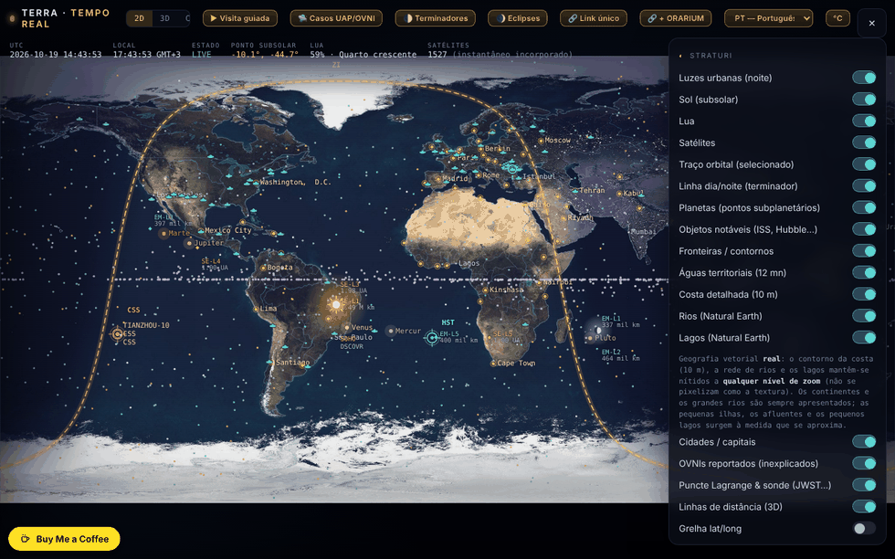

# Terra — a Terra em tempo real

[English](README.md) · [Română](README.ro.md) · [Français](README.fr.md) · [Italiano](README.it.md) · [Español](README.es.md) · **Português** · [Deutsch](README.de.md) · [Magyar](README.hu.md)

**Versão:** 1.7.7 · **Última atualização:** 2026-10-22

Idiomas da interface: **Română, English, Français, Italiano, Español, Português (PT), Deutsch, Magyar**

Mapa e globo da Terra com o terminador dia/noite, a Lua, os planetas, os satélites e um modo «Céu» (planetário), num único ficheiro HTML.

**Online:** https://chiuta.github.io/TerRa/

## O que é

O Terra · tempo real (título da página: «A Terra em tempo real — Terminador · Lua · Satélites») calcula no navegador a posição do Sol, da Lua, dos planetas e dos satélites e apresenta-os num mapa 2D, num globo 3D ou numa vista de planetário («Céu»). Um instantâneo de dados orbitais está incorporado no ficheiro, pelo que funciona também sem internet; os feeds em direto são opcionais.

## Funcionalidades

- Modos: **2D**, **3D** e **Céu**, além de visitas guiadas: «▶ Visita guiada», «🌓 Terminadores», «🌒 Eclipses» e «🛸 Casos OVNI/FANI».
- O terminador dia/noite calculado em tempo real, luzes das cidades no lado noturno, o ponto subsolar, o ponto sublunar e a fase da Lua.
- Controlo do tempo: pausa/reprodução, velocidades (1×, 60×, 600×, 3600×, 1 dia/s), saltos rápidos (−7d … +7d, ±1h) e «Momento exato (local)»; «⦿ Voltar a agora (em direto)».
- Satélites propagados com SGP4 (órbitas baixas) e um modelo kepleriano-J2 (geoestacionários); categorias: estações espaciais, visíveis a olho nu, Starlink, OneWeb, GPS, Galileo, GLONASS, BeiDou, científicos, meteorológicos, observação da Terra, geoestacionários; carregamento de TLE próprios (texto ou ficheiro).
- Planetas e Plutão/Caronte como pontos subplanetários; objetos notáveis (ISS, Tiangong, Hubble), pontos de Lagrange e sondas (JWST, Gaia, Euclid, SOHO, DSCOVR); lista de OVNIs reportados (documenta relatos, não afirma origem extraterrestre).
- Camadas: fronteiras, águas territoriais, costa detalhada, rios e lagos (Natural Earth), cidades / capitais, grelha lat/long, relevo fractal procedimental, mapa vertical para telemóvel.
- Modo «Céu»: Via Láctea, objetos Messier, constelações, chuvas de meteoros, eclítica, observador a partir do solo ou de outros corpos; «Apontar para o céu (AR)» com a bússola/o giroscópio do telemóvel.
- Passagens visíveis da ISS em 48 h, com alerta (vibração + notificação); ambiente de superfície e marés de equilíbrio para a localização escolhida.
- Feeds em direto opcionais: aviões (ADS-B), balões-sonda meteorológicos, radar meteorológico, meteorologia espacial da NOAA (Kp, vento solar, raios X, oval auroral), sismos USGS (24 h), Movebank, fluxo GTFS-RT através de proxy.
- No telemóvel em vertical: botão «⟳ Rodar o mapa» (mapa vertical / horizontal).
- Interface em 8 idiomas: RO, EN, FR, IT, ES, PT, DE, HU (seletor de idioma).
- Atalhos de teclado: `1` / `2` / `3` (2D / 3D / Céu), `Espaço` (pausa / retomar), `N` (voltar a «agora»), `[` e `]` (perspetiva 3D), `Esc`; inativos enquanto escreve num campo. Estão também descritos na janela «Acerca».

## Todos os corpos do ORARIUM (1.4.0)

O TerRa tem agora como observador e como alvo cada um dos 45 corpos do [ORARIUM](https://chiuta.github.io/orarium/): o Sol, os planetas, a Lua, os satélites (incluindo Fobos, Deimos, Hipérion e Caronte, agora acrescentados), os planetas anões e os asteroides (Ceres, Vesta, Palas, Hígia, Psique, Eros, Bennu, Ryugu, Haumea, Makemake, Éris) e o cometa 67P. O aeróstato de Vénus a 50 km não é um corpo separado: tem ligação a partir de Vénus.

- As órbitas dos asteroides e dos planetas anões usam elementos reais do JPL SBDB; Ceres, Eros e Éris coincidem com o JPL Horizons (≤ 0,007 UA). Para Bennu, o instante do periélio é ajustado à efeméride do JPL de 2026-10-18 (os elementos do JPL têm época 2010). Os novos satélites usam o mesmo modelo circular simplificado dos restantes.
- O painel «🕰 A hora noutros mundos» lista os 45 corpos, com o ângulo em relação ao Sol e «⚠ conjunção», e três ligações por linha: ↗ a ficha no ORARIUM, 📡 a janela de transmissão a partir da sua localização, 👁 o céu a partir desse corpo, no TerRa.
- Inversamente, o ORARIUM tem «↗ TerRa» para os 44 corpos (incluindo cada extremidade de um par de comunicação).
- A hora local (meridiano 0) aparece apenas para a Lua e os planetas; para os satélites e os asteroides veja a hora no ORARIUM.

## A ligação ao ORARIUM (1.3.0)

O TerRa e o [ORARIUM](https://chiuta.github.io/orarium/) (a hora em todos os mundos) estão ligados nos dois sentidos, através de ligações únicas, sem rede e sem servidor:

- **O painel «🕰 A hora noutros mundos»**: a hora local (meridiano 0) na Lua e nos planetas no instante da barra de tempo, o próximo meio-dia e a próxima meia-noite, o ângulo em relação ao Sol e o sinal «⚠ conjunção solar». ↗ abre o corpo no ORARIUM; 📡 abre a janela de transmissão a partir de «A minha localização».
- **O modo «Céu» a partir de outro corpo**: por baixo do seletor de observador aparece a hora local no corpo (para os satélites lunares: a hora solar na Lua), com ligações para a ficha do corpo e para a janela de transmissão a partir da sua localização.
- As visitas **«Terminadores»** e **«Eclipses»**: em cada paragem, uma ligação «↗ A hora no corpo / na Lua no ORARIUM».
- **«🔗 + ORARIUM»**: copia duas ligações únicas (a vista no TerRa + a hora/transmissão correspondente no ORARIUM).
- Os cálculos do painel usam as mesmas fórmulas do ORARIUM (orientações da UAI, efemérides keplerianas simplificadas; precisão da ordem dos minutos) e dão resultados idênticos.

## Ligação única (1.2.0)

O botão **«🔗 Ligação única»** copia o endereço exato da vista atual: o modo (2D / 3D / Céu), o observador no modo Céu (a partir de Marte, de Io…), o instante (UTC) e a localização. Quando aberta, a ligação restabelece a vista, com o tempo fixado (em pausa) no instante da ligação. O formato é um fragmento de endereço, sem servidor e sem pedidos de rede:

`#v=sky&o=mars&t=2026-10-18T15:00:00Z&ll=44.43,26.10`

- `v` = `2d` | `3d` | `sky`; `o` = o observador em «Céu» (p. ex. `mars`, `jupiter`, `io`, `luna`, `sun`, `ground`); `t` = o instante ISO em UTC; `ll` = latitude,longitude.
- Os parâmetros em falta ou inválidos são ignorados. Usada também pelo [ORARIUM](https://chiuta.github.io/orarium/) para os botões «Ver no TerRa».

## Funcionalidades novas (1.1.0)

A secção **«Efemérides locais»** do painel (a linha-resumo) e a janela **«Abrir as efemérides locais»**, calculadas localmente, sem rede, com `FFF.ephem`, para «A minha localização» e o instante do controlo de tempo (incluindo tempo simulado):

- **Resumo** no painel: nascer/pôr do Sol, fase da Lua e iluminação.
- **Janela:** Sol (nascer, passagem, pôr, duração do dia, crepúsculos), Lua (fase, iluminação, idade, distância, nascer/pôr, próximas fases) e uma tabela com o Sol, a Lua e os planetas (longitude eclítica com sinal, altitude/azimute, nascer/pôr, magnitude, elongação).
- O fuso horário para as horas: o do navegador por predefinição, editável (nome IANA).
- A precisão declarada está na janela; as horas são arredondadas ao minuto.
- A interface tem 8 línguas (RO, EN, FR, IT, ES, PT, DE, HU), escolhidas no seletor de língua. As traduções fr/it/es/pt/de/hu são **automáticas e não verificadas por falantes nativos**.
- Enquanto a janela está aberta, os atalhos de teclado da aplicação (`1`/`2`/`3`/`Espaço`/`N`) estão inativos; `Esc` fecha a janela.

## Manual de utilização

1. Abra a página; escolha **2D**, **3D** ou **Céu** na barra superior.
2. Defina a localização no painel «A minha localização» (botão «📍 Detetar» ou coordenadas manuais) para as passagens da ISS, as marés e a vista a partir do solo.
3. Abra ☰ para «Camadas» e os restantes painéis; assinale o que pretende ver.
4. Controle o tempo a partir da barra inferior (pausa, velocidade, saltos, «Momento exato»); «⦿ Voltar a agora (em direto)» regressa à hora atual.
5. Arraste para rodar/deslocar, use a roda ou faça pinça para ampliar; toque num satélite ou num marcador para ver detalhes e o rasto orbital. No modo 3D, as teclas `[` e `]` percorrem as perspetivas de observação.
6. Para dados atuais: «⟲ Atualizar (online)» no painel de satélites; «↺ Voltar ao instantâneo offline» repõe os dados incorporados.
7. Feeds em direto: prima os botões «Obter …» dos respetivos painéis (estão desligados por predefinição).
8. Mude o idioma com o botão «EN»/«RO».

## Privacidade e rede

- A aplicação não usa cookies, `localStorage` nem qualquer outro tipo de armazenamento local (não encontrei chamadas de armazenamento no código) e não tem analítica.
- Sem as suas ações, a aplicação não faz pedidos de rede. Quando ativa funcionalidades online, o navegador contacta diretamente:
  - `celestrak.org` (TLE de satélites) e, como alternativa, `raw.githubusercontent.com` (espelho do CelesTrak);
  - `services.swpc.noaa.gov` (meteorologia espacial, oval auroral) e `earthquake.usgs.gov` (sismos);
  - `api.open-meteo.com` (tempo atual na localização escolhida);
  - `opendata.adsb.fi` e `api.adsb.lol` (aviões em redor da sua localização, as coordenadas são enviadas no pedido);
  - `api.v2.sondehub.org` (balões-sonda), `api.rainviewer.com` e `tilecache.rainviewer.com` (radar meteorológico), `www.movebank.org` (dados de animais, estudos públicos);
  - `corsproxy.io`, apenas se introduzir/usar um proxy CORS para fontes que não permitem o acesso direto; o proxy vê esse pedido (a aplicação avisa explicitamente).
- A geolocalização («📍 Detetar») só é pedida ao premir; as notificações do alerta da ISS apenas se ativar o alerta.

- 1.1.0: as efemérides locais não fazem pedidos de rede e não guardam nada; usam «A minha localização» já definida (a geolocalização «📍 Detetar» continua a pedido, como antes). O kit `fff-kit` (`core`, `label`, `bundle`, `ephem`) acrescenta o botão de transparência; no arranque não escreve nada em `localStorage`. Os feeds online enumerados acima não mudaram.
## Nota sobre os casos OVNI/FANI

A lista de casos documenta relatos e não afirma origem extraterrestre. As afirmações atribuídas a pessoas reais (testemunhas, investigadores, investigadores científicos) são reproduzidas da literatura citada e **não foram verificadas de forma independente**; a nota surge também na página (painel «OVNIs reportados» e secção «Acerca», RO/EN). A lista contém atualmente 94 casos (o texto da página diz «mais de 70», o que continua verdadeiro).

## Limites (funcionalidades novas)

- **Efemérides locais — precisão.** Face ao JPL DE421/DE423: posições aparentes do Sol e dos planetas ≤ 3″ (Neptuno ≤ 5″, Plutão ≤ 7″), Lua ≤ 1,5″; nascer/pôr do Sol ≤ 6 s, da Lua ≤ 25 s; fases ≤ 30 s. Face ao pyephem 4.2.1 (teste em `tests/`): nascer/pôr ≤ 0,5 s, fases ≤ 6 s, alt/az ≤ 0,003°. As horas são arredondadas ao minuto. Na realidade o nascer e o pôr do Sol diferem em minutos (refração real, relevo, altitude — não modelados); o ΔT é incerto em ≈ ±1 s em 2027. Não é adequado para navegação. Os cálculos existentes do mapa/globo/céu (terminador, Lua, planetas na vista) não foram substituídos nem modificados; a posição dos satélites continua a depender da idade dos elementos TLE.

## Testes

`node tests/fff-r8.test.mjs` (Playwright a partir de `/opt/node-tools`, Chromium local, rede bloqueada; `tests/_lib.mjs` tem os utilitários comuns). Os valores de referência estão em `tests/ref-c3a.json`: os instantes de nascer/pôr/passagem (Sol, Lua; 5 locais × 4 datas), 56 instantes de fase e 54 posições alt/az, calculados de forma independente com o **pyephem 4.2.1** (usado apenas offline para gerar os números; não faz parte da aplicação). Cada teste tem o seu limiar escrito no código; o teste de acessibilidade (axe-core, `bypassCSP`) corre também em diálogos/painéis abertos, a 1280×800 e 360×740.

## Execução local / offline

Descarregue `index.html` e abra-o no navegador. A posição do Sol, da Lua e dos planetas, o terminador, os eclipses e os satélites do instantâneo incorporado funcionam sem internet; a atualização dos TLE e os feeds em direto requerem internet.

## Licença

MIT — ver o ficheiro LICENSE

## Auditoria

2026-10-10: verificado no navegador que ao carregar e em repouso não sai nenhum pedido de rede; os pedidos surgem apenas com as ações descritas acima. A página não tinha política CSP; a 2026-10-11 foi acrescentada uma, com `connect-src`/`img-src` limitados a `https:` (e não a uma lista fixa de anfitriões), porque o proxy CORS, o endereço GTFS-RT e a imagem do BirdCast são introduzidos pelo utilizador e podem estar em qualquer domínio HTTPS. Foi corrigida a acessibilidade (nomes para os interruptores, zoom permitido) sem alterações funcionais.

## Autor

Alexio — Alexandru-Ionuț Chiuță. Contacto: alexio@trom.tf

## Histórico / Changelog

### 1.7.7 — 2026-10-22

fff-kit 1.1.4: alvos de toque e tamanho mínimo do texto; alvos de toque e texto corrigidos.

### 1.7.6 — 2026-10-22
- fff-kit 1.1.2: PBKDF2 com 600.000 iterações, proteção anti-clickjacking

### 1.7.5 — 2026-10-22
- Móvel: o texto tem pelo menos 12 px e os botões e campos têm áreas táteis maiores em ecrãs estreitos.
- Acessibilidade: a caixa de colagem de TLE, os campos das fontes em direto (GTFS-RT, Movebank, BirdCast, proxy CORS) e os campos de latitude/longitude têm agora um nome anunciado pelos leitores de ecrã (8 idiomas).
- Em ecrãs estreitos, o botão flutuante «Buy Me a Coffee» fica oculto enquanto o painel de controlos está aberto, pelo que já não tapa o texto do painel.

- 1.7.4 — 2026-10-22: **correção**: os nomes dos planetas, a entrada do Hubble, os rótulos «Salto rápido» e «Momento exato (local)» e a etiqueta da ficha OVNI seguem agora o idioma da interface; as listas de planetas, objetos notáveis e pontos de Lagrange são reconstruídas ao mudar de idioma.
### 22 de outubro de 2026 (v1.7.3)
- Corrigido o widget dia/noite («Hora no corpo»): a linha da Terra já não mostra «ângulo em relação ao Sol NaN°» nem um número absurdo de minutos até ao meio-dia/meia-noite (faltava o dia solar da Terra na tabela de períodos e o ângulo ao Sol era calculado para a Terra em relação a si própria).
- Interface: os parágrafos do guia, a secção «Carregar o seu próprio TLE», as etiquetas de maré, as legendas dos casos («relatos», «de 1981»), a legenda das categorias de satélites, os botões «Avançar/Recuar» e o título/a descrição da página acompanham agora o idioma da interface nos 8 idiomas.

### 21 de outubro de 2026 (v1.7.2)
- O cartão e o passo da visita de Valea Plopului foram reformulados e atribuídos: «segundo os relatos … apresentado nas fontes citadas como o primeiro caso atestado e periciado … não verificado de forma independente; o caso continua disputado» (já não é afirmado como facto); a data é «setembro de 1972», a localidade «Poșești», a medição atribuída a Justin Capră «segundo os relatos». A legenda da visita está agora traduzida em fr/it/es/pt/de/hu (antes recorria ao inglês). O texto sobre Valea Plopului está alinhado com ValeaPlopului1972; teste `tests/vp-case.test.mjs`.

### 19 de outubro de 2026 (v1.6.0)
- Novo: «↗ Bolta» no modo Céu (a partir do solo): o mesmo instante e a mesma localização no planetário offline Bolta; sem t= quando a hora é «agora», oculto fora de 1900–2100.
- Privacidade: uma localização obtida por GPS é arredondada a ~1 km nas ligações para o ORARIUM e o Bolta.
- «← voltar» para as fontes ECLIPSA, Eclipsa 2027, Horoscop, Field Observer, Horizons.
- O botão «← voltar» deixa de ser tapado pelo widget Buy Me a Coffee (em baixo à esquerda): fica por cima dele.
- Um aviso discreto «Precisão reduzida após 2100: ΔT extrapolado, Plutão indisponível.» (ro/en, hu/de via en) apenas quando a data simulada ou a de `t=` ultrapassa 2100.

### 18 de outubro de 2026 (v1.5.0)
- Novo: o parâmetro `ufo=<caso>` (p. ex. `#v=2d&ufo=valea-plopului`) centra o mapa 2D no caso da lista OVNI e abre o cartão, sem alterar «A minha localização»; os valores desconhecidos são ignorados. `from=valeaplopului` mostra o botão «← voltar» para ValeaPlopului1972. O texto do caso não foi modificado.

### 18 de outubro de 2026 (v1.4.0)
- Novo: todos os 45 corpos do ORARIUM, com 15 corpos acrescentados (Fobos, Deimos, Hipérion, Caronte, Ceres, Vesta, Palas, Hígia, Psique, Eros, Bennu, Ryugu, Haumea, Makemake, Éris) como observadores e alvos; o painel ORARIUM lista todos os corpos, com ligações nos dois sentidos.

### 18 de outubro de 2026 (v1.3.0)
- Novo: a ligação ao ORARIUM (painel «A hora noutros mundos», faixa no modo Céu, ligações nas visitas, ligação combinada «🔗 + ORARIUM»).

### 18 de outubro de 2026 (v1.2.0)
- Novo: ligação única (fragmento de URL) para modo, observador, instante e localização, além do botão «🔗 Ligação única»; ligação ao ORARIUM.

### 14 de outubro de 2026 (v1.1.0)
- Novo: «Efemérides locais» (linha-resumo no painel + janela modal: Sol, Lua, fases, planetas, crepúsculos, fuso horário editável, precisão declarada); ciclo de idiomas RO/EN/HU/DE para as funcionalidades novas; o kit `fff-kit` (`core`, `label`, `bundle`, `ephem`); `tests/fff-r8.test.mjs` (51 verificações, incluindo axe nos temas claro e escuro, a 1280×800 e 360×740, com a janela aberta). Comparação antes/depois a 1280×800: diferenças inferiores a 0,05% dos píxeis (ruído de animação/WebGL), a captura de ecrã não mudou; a nova secção está no painel de controlos.

### 12 de outubro de 2026 (v1.0.0)
- 1.0.0 — 2026-10-12: a versão e a data da última atualização são apresentadas na aplicação

### 11 de outubro de 2026
- Corrigido (antigo defeito da estrutura HTML): um `
` a mais fechava prematuramente o painel de controlos, pelo que nove secções (Fase da Lua, Planetas, A minha localização, Ambiente de superfície, Marés, etc.) saíam do painel e não podiam ser tocadas; agora todas as 19 secções estão no painel, e o controlo do tempo tem o título «Tempo — passado / futuro».
- «A minha localização»: a vírgula decimal é aceite (`44,43`), e as coordenadas fora do intervalo dão uma mensagem de erro em vez de serem cortadas em silêncio.
- Botão «⟳ Rodar o mapa» no cabeçalho (apenas em 2D, em ecrã estreito na vertical) para alternar rapidamente entre o mapa vertical e o horizontal; as etiquetas permanecem legíveis na orientação horizontal.
- Atalhos de teclado (1/2/3, Espaço, N), com tradução EN na janela «Acerca».
- As etiquetas do mapa 2D (estações, planetas, pontos de Lagrange, sondas, Sol, Lua, objetos notáveis) deixam de se sobrepor: são deslocadas na vertical ou omitidas.
- CSP: `script-src` por hash SHA-256 para os dois scripts, sem `'unsafe-inline'` (as ligações continuam `https:`).
- Nos telemóveis na vertical o mapa 2D arranca agora no modo «Mapa vertical» (preenche o ecrã, as etiquetas são mais legíveis); a barra superior tem fundo semitransparente.
- O painel «Fonte de dados (TLE)» avisa quando os elementos orbitais incorporados são antigos (>7 dias; a 11.10.2026 o instantâneo tem ~107 dias, época mediana 2026-06-26): as posições dos satélites são aproximadas até «Atualizar (online)».
- O conteúdo está envolvido em `<main>` (axe: 0 violações); foi acrescentada uma CSP (`default-src 'none'`, sem scripts externos, apenas `https:` para as ligações).
- Por resolver: o tamanho de 2,1 MB (texturas JPEG + dados do Natural Earth incorporados); recomprimir as imagens ganharia apenas ~5% com perda visível.
